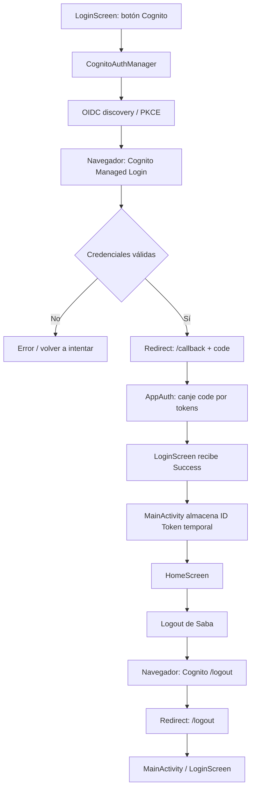
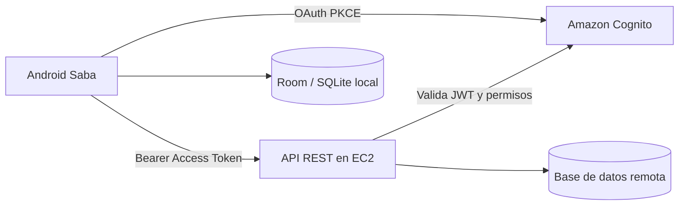

# Saba Android — Guía de estudio completa: Amazon Cognito, OAuth 2.0, PKCE, login y logout

> **Bitácora técnica y material de estudio — 24 de octubre de 2026**  
> Proyecto: **Saba (Android, Kotlin, Jetpack Compose)**  
> Entorno: **AWS Academy de DUOC**, **Amazon Cognito**, **AppAuth-Android**, **Gradle**, **Samsung físico**.  
> **Estado probado:** Cognito autentica a un usuario real, la app recibe los tokens, navega a Home, cierra la sesión web y vuelve a solicitar credenciales en el siguiente login.

## Cómo utilizar esta guía

Esta no es solamente una lista de comandos. En cada tema veremos:

1. **Qué problema había**.
2. **Qué pieza agregamos o modificamos**.
3. **Por qué existe**.
4. **Cómo funciona el código**.
5. **Qué comprobamos realmente**.
6. **Qué deberías poder explicar tú mismo en la defensa**.

Los fragmentos de código están basados en los archivos que compartimos y en el parche de logout de la conversación. Algunos fragmentos son **simplificaciones didácticas** y están rotulados como tales. Los anexos reproducen el **código del parche de referencia**, no aseguran que cada archivo local posterior sea idéntico si lo editaste. Nunca se incluyen contraseñas, tokens reales ni datos de un usuario de Cognito.

**Índice**

- [01. Resumen de lo conseguido](#01-resumen-de-lo-conseguido)
- [02. Problema original: el login falso](#02-problema-original-el-login-falso)
- [03. Conceptos previos de autenticación](#03-conceptos-previos-de-autenticación)
- [04. Servicios de AWS: Cognito frente a EC2](#04-servicios-de-aws-cognito-frente-a-ec2)
- [05. Configuración del User Pool y App Client](#05-configuración-del-user-pool-y-app-client)
- [06. Dominios, issuer y direcciones](#06-dominios-issuer-y-direcciones)
- [07. Explicación completa de OAuth 2.0 + PKCE](#07-explicación-completa-de-oauth-20--pkce)
- [08. Preparación de los módulos en Gradle](#08-preparación-de-los-módulos-en-gradle)
- [09. Variables .env y BuildConfig](#09-variables-env-y-buildconfig)
- [10. La clase CognitoConfig y SabaCognitoConfig](#10-la-clase-cognitoconfig-y-sabacognitoconfig)
- [11. CognitoAuthManager explicado método por método](#11-cognitoauthmanager-explicado-método-por-método)
- [12. CognitoAuthResult y los tres tokens](#12-cognitoauthresult-y-los-tres-tokens)
- [13. Integración con LoginScreen y Compose](#13-integración-con-loginscreen-y-compose)
- [14. Integración con MainActivity y Home](#14-integración-con-mainactivity-y-home)
- [15. Logout web real: problema, corrección y flujo](#15-logout-web-real-problema-corrección-y-flujo)
- [16. AndroidManifest, deep links y callbacks](#16-androidmanifest-deep-links-y-callbacks)
- [17. Contraseña temporal y CloudShell](#17-contraseña-temporal-y-cloudshell)
- [18. Todos los errores que solucionamos](#18-todos-los-errores-que-solucionamos)
- [19. Matriz de pruebas reales](#19-matriz-de-pruebas-reales)
- [20. Límites actuales y seguridad pendiente](#20-límites-actuales-y-seguridad-pendiente)
- [21. Relación con Room, SQLite, Retrofit y EC2](#21-relación-con-room-sqlite-retrofit-y-ec2)
- [22. Checklist para reconstruirlo desde cero](#22-checklist-para-reconstruirlo-desde-cero)
- [23. Preguntas de defensa y respuestas](#23-preguntas-de-defensa-y-respuestas)
- [24. Ejercicios de estudio](#24-ejercicios-de-estudio)
- [25. Glosario de términos](#25-glosario-de-términos)
- [26. Fuentes oficiales](#26-fuentes-oficiales)
- [Anexos: archivos Kotlin y XML de referencia](#anexos-archivos-kotlin-y-xml-de-referencia)

---

## 01. Resumen de lo conseguido

**Antes:** había un formulario que parecía un login real, pero con `BuildConfig.DEBUG` delegaba en `FakeAuthApiService` y emitía un JWT inventado. La navegación hacia Home funcionaba, pero esa autenticación no consultaba identidades reales.

**Después:** existe un botón adicional para iniciar un flujo real hacia el inicio de sesión administrado de Amazon Cognito. Cognito comprueba las credenciales en AWS, regresa a la aplicación mediante una URI registrada y AppAuth intercambia el código de autorización por tokens. La aplicación utiliza el **ID Token** para abrir Home. Al salir de la sesión de Cognito, abre `/logout`, retorna a Saba y en la siguiente prueba vuelve a solicitar credenciales.

| Pieza | Resultado constatado / alcance |
|---|---|
| AWS Academy | Se pudo usar Cognito en el laboratorio |
| User Pool y App Client | Creados; App Client público, sin `client secret` |
| Autorización OAuth | `Authorization Code` habilitado |
| PKCE | Gestionado por AppAuth en la solicitud |
| Login en navegador | Abrió en el Samsung |
| Código → tokens | La app recibió tokens reales |
| Home | La autenticación con Cognito llevó a Home |
| Logout | Después de corregir URI, retornó a la app |
| Segundo login | Volvió a pedir credenciales, según prueba del usuario |
| Persistencia segura de sesión | **No implementada** |
| Renovación y revocación de tokens | **No implementadas** |
| Backend EC2/API protegida | **No implementado todavía** |

La principal lección es distinguir **autenticación**, **autorización**, **sesión web**, **tokens** y **navegación local**. No son la misma cosa.

### El mapa completo



**Para defenderlo:** «Integramos Amazon Cognito con Authorization Code y PKCE usando AppAuth. La autenticación ocurre en el navegador, el callback devuelve un código a Android, AppAuth intercambia ese código por tokens, y la aplicación navega a Home. El logout se maneja aparte para cerrar la sesión web».

---

## 02. Problema original: el login falso

Antes de Cognito, `LoginViewModel.kt` ya separaba UI y lógica usando MVVM, pero contenía una selección de implementación:

```kotlin
private val repository: AuthRepository = AuthRepository(
    if (BuildConfig.DEBUG) FakeAuthApiService()
    else RetrofitClient.authApi
)
```

**Línea por línea:**

- `AuthRepository(...)` recibe la implementación con la que trabajará la pantalla.
- `BuildConfig.DEBUG` es `true` normalmente al ejecutar con **Run** en modo debug.
- `FakeAuthApiService()` simula la API: permite demostrar formularios y navegación sin AWS.
- `RetrofitClient.authApi` es otra implementación HTTP, pero **no era Cognito**; estaba preparada para una API externa.
- De aquí se deduce que probar el primer botón «Ingresar a terreno» en debug **no prueba Cognito**.

Un login simulado no es «malo»: sirve para construir UI, validar RUT/contraseña, manejar `isLoading`, errores y navegación. Lo incorrecto sería presentarlo como verificación de credenciales reales.

**Decisión de diseño:** mantener el login simulado y agregar el botón «Probar inicio de sesión con Cognito» **por separado**. Así no destruimos un flujo de prueba que ya funcionaba mientras construíamos el flujo de AWS.

**Pregunta de estudio:** si una persona introduce `Password123` en el formulario de prueba y llega a Home, ¿qué demostró? Solo que funcionó el flujo simulado; no que Cognito verificó la contraseña.

---

## 03. Conceptos previos de autenticación

### 03.1 Identificación, autenticación y autorización

- **Identificación:** quién dices ser (correo, nombre de usuario, `sub`).
- **Autenticación:** demostrar al proveedor de identidad que eres esa persona (por ejemplo, credenciales de Cognito).
- **Autorización:** decidir qué recursos y operaciones te permite utilizar el sistema. Iniciar sesión no da permiso automático a todas las operaciones del estacionamiento.

Ejemplo de Saba: un trabajador puede autenticar correctamente con Cognito y aun así **no** tener permisos para eliminar incidencias. Esa segunda decisión deberá tomarla nuestro backend según roles y reglas confiables.

### 03.2 ¿Qué es un User Pool?

Es el directorio de identidades de Cognito: contiene usuarios, atributos (p. ej. correo), estados de cuenta y políticas de autenticación. **No** sustituye a nuestra tabla `User` de Room: Cognito gestiona identidad; Room modela información de negocio local.

### 03.3 ¿Qué es un App Client?

Representa una aplicación concreta autorizada para usar el User Pool. Nuestro cliente se llamó `APP_MOVIL_SABA` y se creó como cliente **público sin secreto**.

Un `client_id` **identifica** la aplicación, no es una contraseña. Un teléfono Android no es un entorno fiable para guardar un `client_secret`, porque el APK puede ser inspeccionado.

### 03.4 ¿Qué es AppAuth?

**AppAuth-Android** es una biblioteca de OAuth 2.0/OpenID Connect que nos ayuda a construir solicitudes de autorización, lanzar el navegador, recibir el resultado, manejar PKCE e intercambiar códigos por tokens. **No es Amplify** y tampoco es una biblioteca de AWS exclusiva.

### 03.5 ¿Qué es OpenID Connect (OIDC)?

OIDC añade una capa de identidad encima de OAuth 2.0. Entre otras cosas define el **ID Token**, que permite a la aplicación reconocer al usuario autenticado.

### 03.6 ¿Qué es una cookie?

Es información del navegador que puede representar una sesión web en el proveedor de identidad. **La cookie de Cognito en Chrome y el JWT temporal que utiliza Saba son cosas diferentes**.

---

## 04. Servicios de AWS: Cognito frente a EC2

| Servicio | Para qué lo usamos / usaremos |
|---|---|
| **Amazon Cognito** | Registrar/autenticar identidades y entregar tokens |
| **Amazon EC2** | Hospedar nuestra propia API REST en una máquina virtual (etapa posterior) |
| **Room/SQLite** | Guardar datos locales en el Samsung |
| **Retrofit/OkHttp** | Realizar peticiones HTTP desde Saba al backend |

**Cognito no necesita EC2 para funcionar.** Lo demostramos: el usuario se autenticó desde el Samsung antes de desplegar un servidor EC2.

Arquitectura futura:



La base remota, sincronización y la comprobación de permisos todavía son trabajo futuro. Un JWT por sí solo no sincroniza SQLite ni crea una API.

---

## 05. Configuración del User Pool y App Client

### 05.1 Acceder al laboratorio

Entramos a AWS Academy / Learner Lab de DUOC y comprobamos que Cognito estaba disponible. Los laboratorios educativos pueden tener permisos limitados; que la consola abra no garantiza permiso para todas las operaciones administrativas.

### 05.2 Crear el User Pool

Se creó un User Pool con un nombre elegido por el estudiante (el **nombre visible es arbitrario**). Lo que importa para el código son su **región e identificador**.

El proveedor de identidad de los usuarios se configuró dentro de Cognito. La pantalla de autenticación observada en el Samsung solicitó **correo electrónico**, lo que demuestra el identificador exigido por el flujo efectivo. Nuestra UI simulada, en cambio, solicita RUT. **No son equivalentes ni se deben confundir.**

### 05.3 Crear `APP_MOVIL_SABA`

En el User Pool se configuró un App Client de aplicación móvil:

- Tipo **Mobile application**.
- Sin `client secret`.
- Flujo de concesión OAuth **Authorization code grant**.
- Permisos OIDC utilizados por el proyecto: `email openid phone`.
- Duración de tokens configurada en la consola (las capturas mostraban Access/ID Token de 60 minutos y Refresh Token de 5 días; esos valores son configurables, no constantes del código).
- Proveedor de identidad: directorio de usuarios del User Pool.

El App Client también tenía SRP habilitado; **SRP no sustituye la configuración de OAuth + PKCE** que usamos en el navegador. Son mecanismos distintos.

### 05.4 Configurar la página gestionada de Cognito

El User Pool necesita un dominio de inicio de sesión administrado y una página disponible para el App Client. En AWS revisamos la pestaña **Páginas de inicio de sesión**, donde se indican los flujos, scopes, proveedor de identidad y URLs permitidas.

### 05.5 Las URLs finales

```text
Callback para LOGIN:
com.example.appsaba://cognito/callback

Retorno para LOGOUT:
com.example.appsaba://cognito/logout
```

Estas dos direcciones están deliberadamente separadas:

- `/callback` recibe la respuesta de la autorización.
- `/logout` indica que terminó la salida del navegador.

**Advertencia:** el parámetro `COGNITO_LOGOUT_URI` fue inicialmente idéntico a `/callback`. Eso causó el error posterior al salir de la sesión, aunque el login sí funcionaba. Lo corregimos a `/logout`.

### 05.6 Dos clases de URL en AWS

- **Allowed callback URLs**: autorizan el retorno de la operación `/oauth2/authorize`.
- **Allowed sign-out URLs**: autorizan el destino de `logout_uri` en `/logout`.

Una URL puede existir en el archivo `.env` y aun así ser rechazada por Cognito si no se registró donde corresponde. **Deben coincidir carácter por carácter**: esquema, host, ruta y cualquier barra.

---

## 06. Dominios, issuer y direcciones

Esta fue una de las partes más importantes del debugging.

### 06.1 `issuerUri`: identidad del emisor OIDC

```text
https://cognito-idp.us-east-1.amazonaws.com/<USER_POOL_ID>
```

Esta URL **no es la pantalla que ve el usuario**. Es el identificador OIDC del User Pool. Se usa para descubrir automáticamente endpoints y verificar quién emitió un token.

`us-east-1` indica la región que usamos. `<USER_POOL_ID>` debe reemplazarse por el valor de la consola de AWS, **no por el nombre del User Pool**.

### 06.2 Dominio del navegador / Managed Login

Ejemplo genérico:

```text
https://<tu-dominio-cognito>.auth.us-east-1.amazoncognito.com
```

El navegador se conecta al **dominio de inicio de sesión**, que ofrece endpoints como:

```text
/oauth2/authorize
/oauth2/token
/logout
```

Por eso fue un error pensar que podíamos fabricar `/logout` añadiéndolo al `issuerUri`: son **hosts con funciones diferentes**.

### 06.3 OpenID Discovery

OIDC publica metadatos en `/.well-known/openid-configuration`. AppAuth consulta esos metadatos y obtiene, entre otros:

- `authorization_endpoint` — comenzar autorización.
- `token_endpoint` — canjear el código por tokens.
- `jwks_uri` — claves públicas para comprobar firmas.

La documentación oficial explica que Cognito ofrece discovery desde el issuer del User Pool; **el dominio del navegador se obtiene de los endpoints descubiertos**, no se adivina.

### 06.4 Custom scheme de Android

```text
com.example.appsaba://cognito/callback
└────── esquema ─────┘ └host┘└ruta─┘
```

`com.example.appsaba` parece el package, pero aquí actúa como **esquema de URI**. Android lo utiliza para decidir qué app puede recibir el enlace. Este diseño funciona en nuestro teléfono de pruebas, aunque para una aplicación pública es conveniente evaluar **Android App Links HTTPS verificados**, que reducen riesgos de interceptación por otras apps.

---

## 07. Explicación completa de OAuth 2.0 + PKCE

### 07.1 ¿Por qué no enviamos la contraseña desde el formulario Compose?

Para el flujo elegido, **Saba no recibe directamente la contraseña del usuario de Cognito**. La persona escribe sus credenciales en el navegador del proveedor. Saba recibe un **código de autorización**, que luego intercambia por tokens mediante AppAuth.

La ventaja es que nuestra UI Kotlin no necesita gestionar esas contraseñas y el proveedor puede aplicar sus propias políticas de autenticación.

### 07.2 Authorization Code

1. Saba abre la autorización de Cognito.
2. El usuario se autentica en el navegador.
3. Cognito responde a nuestro callback con un **código temporal**, no directamente con un Access Token en la URL.
4. AppAuth entrega el código al endpoint `/oauth2/token`.
5. Cognito devuelve los tokens.

### 07.3 ¿Por qué necesitamos PKCE?

Una app móvil es un **cliente público**: no puede proteger un secreto de cliente. PKCE reduce el riesgo de que otro actor robe un código de autorización y lo canjee.

Secuencia simplificada:

```text
App genera code_verifier (valor aleatorio privado)
             |
             v
SHA-256 + Base64URL -> code_challenge
             |
             v
/oauth2/authorize lleva code_challenge
             |
             v
Cognito devuelve authorization code
             |
             v
/oauth2/token recibe code + code_verifier
             |
             v
Cognito comprueba que verifier coincide con challenge
             |
             v
Entrega tokens si todo es válido
```

En el código **no implementamos manualmente SHA-256 ni guardamos el verifier en nuestra propia clase**; AppAuth lo administra en `AuthorizationRequest`. Cognito acepta `S256` para este flujo.

### 07.4 ¿Qué es `state`?

Es un valor usado por el flujo de autorización para asociar la respuesta a la solicitud y mitigar ataques de redirección/CSRF. AppAuth se encarga de gestionarlo en la operación. No es lo mismo que `StateFlow` de Kotlin.

### 07.5 ¿Qué son los `scopes`?

Son los permisos solicitados. En nuestra configuración:

```text
email openid phone
```

- `openid` habilita el contexto OIDC y el **ID Token**.
- `email` permite solicitar atributos relacionados con correo cuando estén disponibles.
- `phone` permite solicitar atributos relacionados con teléfono cuando correspondan.

**Un scope no es un rol administrativo** y no significa que cualquier usuario pueda modificar una incidencia.

### 07.6 Resumen comparativo

| Elemento | ¿Qué es? | ¿Para qué lo usamos? |
|---|---|---|
| `code` | Código temporal de autorización | Canje por tokens |
| `code_verifier` | Valor PKCE privado de esta solicitud | Demostrar continuidad de la autorización |
| `code_challenge` | Derivado del verifier | Inicio del PKCE |
| `state` | Correlación de solicitud y respuesta | Protección del flujo |
| `client_id` | ID público del App Client | Identificar Saba |
| `redirect_uri` | URI registrada para login | Volver a Android |
| `logout_uri` | URI registrada para salida | Volver tras cerrar sesión web |

---

## 08. Preparación de los módulos en Gradle

### 08.1 ¿Por qué hay dos módulos?

```text
AppSaba/
├── app/             # UI, MainActivity, Compose, Room, config de Saba
├── cognito-auth/    # biblioteca reutilizable para OAuth/AppAuth
├── gradle/
│   └── libs.versions.toml
└── settings.gradle.kts
```

La biblioteca `cognito-auth` sabe **cómo ejecutar el protocolo**. El módulo `app` sabe **cómo presentar pantallas y qué hacer cuando el usuario entra o sale**. La biblioteca no debería conocer clases como `HomeScreen` o `SabaDataScreen`.

### 08.2 Alinear `minSdk`

Detectamos que el módulo `cognito-auth` declaraba `minSdk = 28`, mientras que Saba usaba `minSdk = 26`. Alineamos la biblioteca a 26 para no obligar a elevar el mínimo de la aplicación.

```kotlin
// cognito-auth/build.gradle.kts
android {
    defaultConfig {
        minSdk = 26
    }
}
```

**La versión compilada depende también de que las dependencias sean compatibles con ese mínimo.** Lo comprobamos mediante la compilación de tu entorno.

### 08.3 Declarar dependencias en `libs.versions.toml`

En el catálogo de versiones se añadieron alias utilizados por el módulo:

```toml
[versions]
appauth = "0.11.1"

[libraries]
appauth = { group = "net.openid", name = "appauth", version.ref = "appauth" }
lifecycle-viewmodel-ktx = { group = "androidx.lifecycle", name = "lifecycle-viewmodel-ktx", version.ref = "lifecycleRuntimeKtx" }
```

El módulo ya hacía referencia a `libs.appauth`, `libs.lifecycle.viewmodel.ktx`, `libs.coroutines.core` y `libs.coroutines.android`. Si falta la entrada TOML de una de ellas, Gradle no puede resolver el alias.

### 08.4 Registrar el proyecto Gradle

```kotlin
// settings.gradle.kts
include(":app")
include(":cognito-auth")
```

Esto hace que Gradle conozca **ambos proyectos**.

Después, el módulo principal declara la dependencia:

```kotlin
// app/build.gradle.kts

dependencies {
    implementation(project(":cognito-auth"))
}
```

**Diferencia que debes memorizar:**

- `include(":cognito-auth")` = registrar un módulo en el build.
- `implementation(project(":cognito-auth"))` = permitir que `app` utilice ese módulo.

### 08.5 `UnknownProjectException`

Apareció este error:

```text
Project with path ':cognito-auth' could not be found.
```

Al final descubrimos que **Android Studio estaba abierto en el proyecto de otra persona**, no en nuestro Saba. Esto enseña a comprobar primero la raíz del proyecto abierto y el árbol de carpetas, antes de modificar más dependencias.

### 08.6 `manifestPlaceholders`

```kotlin
manifestPlaceholders["appAuthRedirectScheme"] = "com.example.appsaba"
```

Este parámetro ayuda a AppAuth a registrar el esquema de retorno para la respuesta OAuth. El esquema debe coincidir con la URI de login configurada.

---

## 09. Variables .env y BuildConfig

### 09.1 ¿Por qué no escribimos identificadores dentro de `CognitoAuthManager.kt`?

Porque queremos reutilizar el módulo con otro User Pool o incluso otra aplicación. El módulo conoce las **propiedades**, no los valores concretos.

Archivo local `.env` (ejemplo con placeholders):

```dotenv
COGNITO_ISSUER=https://cognito-idp.us-east-1.amazonaws.com/<TU_USER_POOL_ID>
COGNITO_CLIENT_ID=<TU_APP_CLIENT_ID_PUBLICO>
COGNITO_REDIRECT_URI=com.example.appsaba://cognito/callback
COGNITO_LOGOUT_URI=com.example.appsaba://cognito/logout
COGNITO_SCOPES=email openid phone
```

La **diferencia crucial** que resolvió nuestro error de logout es que la cuarta línea termina en `/logout`.

### 09.2 Android no lee `.env` automáticamente

Gradle lee esas propiedades **al compilar** y las expone como campos de `BuildConfig`. En nuestro proyecto existía infraestructura para leer `.env` con `Properties`.

Fragmento del paso que aplicamos (resumido):

```kotlin
val cognitoVariables = listOf(
    "COGNITO_ISSUER",
    "COGNITO_CLIENT_ID",
    "COGNITO_REDIRECT_URI",
    "COGNITO_LOGOUT_URI",
    "COGNITO_SCOPES"
)

cognitoVariables.forEach { key ->
    val value = envProps.getProperty(key)
        ?: System.getenv(key)
        ?: ""
    require(value.isNotBlank()) { "Falta configurar $key en .env" }
    buildConfigField("String", key, "\"$value\"")
}
```

**Nota:** el fragmento anterior asume que `envProps` se inicializó antes de `android {}` y que `buildConfigField` se ejecuta dentro de `defaultConfig`. No lo copies suelto fuera de contexto.

- `listOf(...)` define qué claves necesitamos.
- `forEach` procesa cada clave.
- `getProperty(key)` busca primero en `.env`.
- `System.getenv(key)` permite un valor del entorno si no está en el archivo.
- `require(...)` falla temprano si falta la variable.
- `buildConfigField` crea una constante accesible desde `BuildConfig` del módulo `app`.

### 09.3 Flujo de configuración

```text
.env (proyecto, al compilar)
        ↓
Gradle + Properties
        ↓
BuildConfig.COGNITO_ISSUER, etc.
        ↓
SabaCognitoConfig.create()
        ↓
CognitoConfig
        ↓
CognitoAuthManager
```

### 09.4 ¿Es un archivo secreto?

**No debemos poner contraseñas ni client secrets en `.env` + `BuildConfig`.** Los valores terminan incorporados al APK, que puede inspeccionarse. El `client_id` público, issuer, scopes y URIs **no son secretos**, aunque sí conviene mantener el `.env` fuera del repositorio por higiene y para separar entornos.

En `.gitignore` agregamos, conservando las reglas anteriores:

```gitignore
.gradle/
**/build/
local.properties
.env
.env.*
!.env.example
```

`!.env.example` nos permite subir una **plantilla sin valores personales**. Si un archivo ya había sido rastreado por Git, `.gitignore` por sí solo no lo elimina del índice.

---

## 10. La clase CognitoConfig y SabaCognitoConfig

### 10.1 `CognitoConfig.kt` pertenece a la biblioteca reutilizable

```kotlin
data class CognitoConfig(
    val issuerUri: String,
    val clientId: String,
    val redirectUri: String,
    val logoutUri: String = redirectUri,
    val scopes: String = "email openid phone",
) {
    val issuerNetUri: Uri get() = Uri.parse(issuerUri)
    val redirectNetUri: Uri get() = Uri.parse(redirectUri)

    fun validate() {
        require(issuerUri.isNotBlank())
        require(clientId.isNotBlank())
        require(redirectUri.isNotBlank())
    }
}
```

**Línea por línea:**

- `data class` representa un conjunto de valores y genera utilidades (`copy`, `equals`, `toString`, etc.).
- `val issuerUri`: string del emisor OIDC.
- `val clientId`: identificador público del cliente móvil.
- `redirectUri`: retorno del **login**.
- `logoutUri`: retorno del **logout**; su valor predeterminado es `redirectUri`, pero **nosotros lo sobrescribimos para usar `/logout`**.
- `scopes`: cadena de permisos solicitados.
- `issuerNetUri` y `redirectNetUri`: conversión de `String` a `android.net.Uri`.
- `require`: detiene una configuración evidentemente incompleta con `IllegalArgumentException`.

**Límite de `validate()`:** comprueba que algunos strings no estén vacíos, pero **no** demuestra que AWS tenga esos valores ni que las URIs estén autorizadas. Eso solo se confirma al ejecutar el flujo real.

### 10.2 `SabaCognitoConfig.kt` pertenece a nuestra aplicación

Creamos este archivo en el paquete **que ya existía**: `com.example.appsaba.config`.

```kotlin
package com.example.appsaba.config

import com.cognitoauth.CognitoConfig
import com.example.appsaba.BuildConfig

object SabaCognitoConfig {
    fun create(): CognitoConfig {
        return CognitoConfig(
            issuerUri = BuildConfig.COGNITO_ISSUER,
            clientId = BuildConfig.COGNITO_CLIENT_ID,
            redirectUri = BuildConfig.COGNITO_REDIRECT_URI,
            logoutUri = BuildConfig.COGNITO_LOGOUT_URI,
            scopes = BuildConfig.COGNITO_SCOPES
        )
    }
}
```

Aquí hay **dos responsabilidades diferentes**:

- `CognitoConfig` declara **qué datos necesita** la biblioteca.
- `SabaCognitoConfig` conoce **de dónde obtiene** esos datos la aplicación Saba.

**¿Por qué `object`?** Kotlin ofrece una instancia única de este proveedor de funciones; no necesitamos crear varios objetos de configuración sin estado.

---

## 11. CognitoAuthManager explicado método por método

El archivo principal de la biblioteca es `com.cognitoauth.CognitoAuthManager`. Es una **fachada**, es decir, una clase que reúne operaciones de AppAuth en una interfaz que nuestra aplicación entiende.

### 11.1 Constructor

```kotlin
class CognitoAuthManager(
    context: Context,
    val config: CognitoConfig,
    appAuthConfig: AppAuthConfiguration = AppAuthConfiguration.Builder().build(),
) {
    init { config.validate() }
    private val authService = AuthorizationService(
        context.applicationContext, appAuthConfig
    )
}
```

- Recibe el `Context` para crear y usar servicios Android.
- Recibe `CognitoConfig` con el issuer, cliente y URIs.
- Puede recibir configuración avanzada de AppAuth, pero provee una predeterminada.
- Valida strings de configuración al comenzar.
- Usa `applicationContext` para no retener innecesariamente una Activity de UI.

### 11.2 Descubrir endpoints

```kotlin
@Volatile
private var serviceConfig: AuthorizationServiceConfiguration? = null

suspend fun serviceConfiguration(): AuthorizationServiceConfiguration =
    serviceConfig ?: fetchServiceConfig().also { serviceConfig = it }
```

**¿Para qué sirve?** Para que AppAuth conozca los endpoints de autorización y token del User Pool sin escribirlos a mano.

`serviceConfig` comienza en `null`. La primera llamada hace discovery. Después se reutiliza el resultado.

`@Volatile` mejora la visibilidad de la referencia entre hilos, pero no convierte toda la inicialización en atómica: dos peticiones simultáneas podrían hacer discovery dos veces. Para nuestro escenario de un botón de login fue suficiente, pero podría robustecerse.

`fetchServiceConfig()` usa:

```kotlin
suspendCancellableCoroutine { cont ->
    AuthorizationServiceConfiguration.fetchFromIssuer(
        config.issuerNetUri,
        AuthorizationServiceConfiguration.RetrieveConfigurationCallback { cfg, ex ->
            if (cfg != null) cont.resume(cfg)
            else cont.resumeWith(
                Result.failure(ex ?: IllegalStateException("No se pudo descubrir Cognito"))
            )
        }
    )
}
```

**¿Por qué `suspendCancellableCoroutine`?** `fetchFromIssuer` utiliza un callback asíncrono; Kotlin permite envolverlo para poder escribir un flujo secuencial con `suspend`. Esta envoltura **no garantiza por sí misma que el trabajo de red subyacente se cancele**; es una mejora futura de robustez.

### 11.3 Construir solicitud de autorización

```kotlin
suspend fun buildAuthRequest(): AuthorizationRequest {
    val cfg = serviceConfiguration()
    return AuthorizationRequest.Builder(
        cfg,
        config.clientId,
        ResponseTypeValues.CODE,
        config.redirectNetUri,
    ).setScope(config.scopes).build()
}
```

Se pide `ResponseTypeValues.CODE`, es decir, **código de autorización**. No pedimos que nos entregue tokens directamente en la URL.

El `clientId` identifica a Saba ante Cognito. `redirectNetUri` define dónde recibiremos la respuesta. `setScope` indica los scopes.

**AppAuth se encarga de los detalles del flujo PKCE**, incluido el `code_challenge` y el verifier correspondiente.

### 11.4 Construir el `Intent`

```kotlin
suspend fun buildAuthIntent(): Intent {
    val request = buildAuthRequest()
    return authService.getAuthorizationRequestIntent(request)
}
```

Un `Intent` es un mensaje del sistema Android para solicitar una acción. Aquí se prepara la operación de autorización que abre el navegador compatible. **Preparar un Intent no significa iniciar sesión**: el navegador debe abrirse y el usuario debe autenticarse.

### 11.5 Canjear el código por tokens

```kotlin
fun exchangeCode(data: Intent?, onResult: (CognitoAuthResult) -> Unit) {
    val resp = data?.let { AuthorizationResponse.fromIntent(it) }
    val ex = data?.let { AuthorizationException.fromIntent(it) }

    if (resp == null) {
        if (ex != null) onResult(CognitoAuthResult.Failure(
            ex.message ?: "Autorización fallida", ex
        ))
        else onResult(CognitoAuthResult.Cancelled)
        return
    }

    authService.performTokenRequest(
        resp.createTokenExchangeRequest(),
        AuthorizationService.TokenResponseCallback { token, tokenEx ->
            // Adaptación de token/tokenEx a Success o Failure.
        }
    )
}
```

**Diferencia entre `code` y `token`:** el callback de navegador devuelve una respuesta de autorización; `performTokenRequest` realiza una petición posterior al endpoint de token. Solo después de esa petición tenemos **ID Token / Access Token / Refresh Token**.

**¿Por qué un callback `onResult`?** El intercambio también es asíncrono: el método no puede devolver inmediatamente los tokens, pues debe esperar respuesta HTTP.

### 11.6 `dispose()`

```kotlin
fun dispose() = authService.dispose()
```

Libera recursos asociados al `AuthorizationService` cuando deja de ser necesario. Lo utilizamos desde `DisposableEffect` en LoginScreen.

### 11.7 Método de logout

El **método final del parche** no utiliza directamente `EndSessionRequest`: construye la URL `/logout` **a partir del host correcto** del endpoint de autorización descubierto:

```kotlin
@Suppress("UNUSED_PARAMETER")
suspend fun buildLogoutIntent(idToken: String? = null): Intent {
    val authorizationEndpoint = serviceConfiguration().authorizationEndpoint
    require(authorizationEndpoint.scheme == "https")

    val logoutUrl = authorizationEndpoint.buildUpon()
        .path("/logout")
        .clearQuery()
        .fragment(null)
        .appendQueryParameter("client_id", config.clientId)
        .appendQueryParameter("logout_uri", config.logoutUri)
        .build()

    return Intent(Intent.ACTION_VIEW, logoutUrl)
        .addCategory(Intent.CATEGORY_BROWSABLE)
}
```

**Línea por línea:**

1. Consulta la configuración OIDC.
2. Extrae `authorizationEndpoint` (un endpoint del dominio de Managed Login).
3. Comprueba `https`.
4. Conserva el host y reemplaza el path por `/logout`.
5. Quita query/fragments previos.
6. Agrega `client_id`.
7. Agrega `logout_uri` (la ruta autorizada `/logout` de Android).
8. Devuelve un `ACTION_VIEW` para abrirla en navegador.

**Importante:** aquí cerrar sesión web **no revoca automáticamente** los tokens emitidos. La revisión de seguridad queda pendiente.

---

## 12. CognitoAuthResult y los tres tokens

### 12.1 Resultado fuertemente tipado

En `CognitoAuthResult.kt` tenemos una interfaz sellada:

```kotlin
sealed interface CognitoAuthResult {
    data class Success(val tokens: CognitoTokens) : CognitoAuthResult
    data class Failure(
        val message: String,
        val cause: Throwable? = null
    ) : CognitoAuthResult
    data object Cancelled : CognitoAuthResult
}
```

**¿Por qué `sealed`?** Porque Kotlin conoce de antemano las variantes de resultado; un `when` exhaustivo puede tratar éxito, error y cancelación sin mezclarlos.

Ejemplo de lógica conceptual:

```kotlin
when (resultado) {
    is CognitoAuthResult.Success -> { /* continuar */ }
    is CognitoAuthResult.Failure -> { /* mostrar mensaje */ }
    CognitoAuthResult.Cancelled -> { /* no autenticar */ }
}
```

### 12.2 Contenedor de tokens

```kotlin
data class CognitoTokens(
    val idToken: String?,
    val accessToken: String?,
    val refreshToken: String?,
    val expiresIn: Long? = null,
)
```

**No son tres formas de llamar al mismo token**:

| Token | Función | Situación en Saba |
|---|---|---|
| **ID Token** | Identidad y claims del usuario | Se entrega a Home para mostrar su información |
| **Access Token** | Autorizar peticiones a APIs protegidas | Se recibe, pero aún **no se conserva como sesión del backend EC2** |
| **Refresh Token** | Obtener tokens nuevos cuando expiran | Puede recibirse, pero **no se guarda ni utiliza todavía** |

### 12.3 Estructura JWT

```text
HEADER.PAYLOAD.SIGNATURE
```

Cada token JWT tiene un contenido codificado. **Decodificar el payload no demuestra que el token sea genuino**. Nuestro `JwtDecoder` en Home solo divide el JWT y decodifica Base64URL, por lo que **no valida la firma**.

**Para EC2 sí necesitaremos validación real en servidor**: firma con JWKS, issuer `iss`, `exp`, uso del token (`token_use=access`), cliente/audiencia según tipo de token y permisos.

### 12.4 Expiración

`accessTokenExpirationTime` viene en milisegundos de época. El código calcula:

```kotlin
expiresIn = token.accessTokenExpirationTime?.let {
    (it - System.currentTimeMillis()) / 1000
}
```

Es una estimación de **segundos restantes** en el instante del intercambio; no constituye un sistema de renovación automática. Si no hay fecha, se deja `null`.

---

## 13. Integración con LoginScreen y Compose

### 13.1 Ubicación después de la reorganización

El archivo vive en:

```text
app/src/main/java/com/example/appsaba/ui/login/LoginScreen.kt
package com.example.appsaba.ui.login
```

No movimos la pantalla a otro paquete: respetamos tu reordenamiento. Por eso su configuración importa cuando algún import cambia.

### 13.2 El manager se crea una vez durante la vida de la pantalla

```kotlin
val context = LocalContext.current
val scope = rememberCoroutineScope()
val cognitoManager = remember(context) {
    CognitoAuthManager(context.applicationContext, SabaCognitoConfig.create())
}
DisposableEffect(cognitoManager) {
    onDispose { cognitoManager.dispose() }
}
```

- `LocalContext.current`: da acceso al Context Android.
- `remember`: evita recrear el manager en cada recomposición de Compose.
- `rememberCoroutineScope`: crea un ámbito para operaciones asíncronas disparadas desde la UI.
- `DisposableEffect`: cierra el recurso cuando el composable deja de utilizarlo.

**Recuerda** que una recomposición no significa crear toda la pantalla desde cero; Compose puede ejecutar nuevamente funciones composables cuando cambia el estado.

### 13.3 Estado de progreso y mensajes

```kotlin
var cognitoBusy by remember { mutableStateOf(false) }
var cognitoMessage by remember { mutableStateOf<String?>(null) }
```

- `cognitoBusy` indica que el proceso está en curso; evita lanzar repetidas peticiones de login.
- `cognitoMessage` conserva un error o información textual que la pantalla muestra.

### 13.4 `ActivityResultLauncher`

```kotlin
val cognitoLauncher = rememberLauncherForActivityResult(
    ActivityResultContracts.StartActivityForResult()
) { activityResult ->
    cognitoManager.exchangeCode(activityResult.data) { authResult ->
        scope.launch {
            // Actualizar estado de Compose y actuar sobre el resultado.
        }
    }
}
```

Android puede abrir una Activity externa (el flujo de navegador de AppAuth). Cuando termina, recibimos el resultado en un callback.

Esto **no es lo mismo que recibir directamente el token del navegador**: `exchangeCode` realiza el canje posterior.

### 13.5 Botón de Cognito

```kotlin
onCognitoClick = {
    if (!cognitoBusy) {
        cognitoBusy = true
        cognitoMessage = null
        scope.launch {
            try {
                cognitoLauncher.launch(cognitoManager.buildAuthIntent())
            } catch (cancelled: CancellationException) {
                cognitoBusy = false
                throw cancelled
            } catch (error: Exception) {
                cognitoBusy = false
                cognitoMessage = "No se pudo abrir Cognito: ${error.message}"
            }
        }
    }
}
```

¿Por qué usamos `scope.launch`? Porque `buildAuthIntent()` es `suspend`: primero puede tener que hacer **discovery por red**.

¿Por qué se vuelve a lanzar `CancellationException`? Porque cancelar una corrutina no debería tratarse como un error de autenticación normal.

### 13.6 Validar respuesta y navegar

La versión final del parche distingue dos callbacks:

```kotlin
fun LoginScreen(
    viewModel: LoginViewModel = viewModel(),
    onLoginSuccess: (token: String) -> Unit = {},
    onCognitoLoginSuccess: (token: String) -> Unit = onLoginSuccess
)
```

Al obtener éxito:

```kotlin
is CognitoAuthResult.Success -> {
    val idToken = authResult.tokens.idToken
    val accessToken = authResult.tokens.accessToken
    if (!idToken.isNullOrBlank() && !accessToken.isNullOrBlank()) {
        onCognitoLoginSuccess(idToken)
        null
    } else {
        "Cognito respondió, pero faltan tokens esperados."
    }
}
```

Esto comprueba que llegaron ambos tokens esperados. Luego **entrega solamente el ID Token** a MainActivity. El Access Token y Refresh Token no pasan a un gestor central de sesión: esa es una **limitación pendiente**, no una función que ya hayamos terminado.

### 13.7 ¿Qué hace `LoginContent`?

`LoginContent` dibuja campos, botones y mensajes. Sigue conservando el botón **«Ingresar a terreno»** y la validación del formulario simulado. Si existe `onCognitoClick`, muestra un `OutlinedButton` adicional para las pruebas reales.

Así dividimos:

- `LoginScreen`: composición con ViewModel, launcher, manager y callbacks.
- `LoginContent`: apariencia y controles del formulario.

**Detalle pedagógico:** el login Cognito **todavía no está orquestado por `LoginViewModel`**. La integración actual vive principalmente en el composable, porque priorizamos conectar y verificar el flujo en la fecha de entrega. Migrarlo a un repositorio/gestor de sesión y un ViewModel de autenticación es una mejora arquitectónica posterior.

---

## 14. Integración con MainActivity y Home

### 14.1 ¿Dónde se decide navegar?

`MainActivity` posee el estado de sesión y el estado de navegación simple.

```kotlin
var token: String? by remember { mutableStateOf(null) }
var isCognitoSession by remember { mutableStateOf(false) }
var showLocalData by rememberSaveable { mutableStateOf(false) }
```

- `token`: referencia temporal al JWT que decide si se muestra Login o Home.
- `isCognitoSession`: indica **qué tipo de login** generó la sesión; sirve para decidir si hay que invocar `/logout`.
- `showLocalData`: decide si se abre la pantalla de Room.

### 14.2 Distinguir login simulado de Cognito

```kotlin
LoginScreen(
    onLoginSuccess = { t ->
        token = t
        isCognitoSession = false
        showLocalData = false
    },
    onCognitoLoginSuccess = { t ->
        token = t
        isCognitoSession = true
        showLocalData = false
    }
)
```

Mismo destino visual (Home), distinta **procedencia de autenticación**. Esto impide tratar un JWT falso como si fuera una sesión real de Cognito al cerrar sesión.

### 14.3 Navegación actual

```kotlin
if (currentToken == null) {
    LoginScreen(...)
} else if (showLocalData) {
    SabaDataScreen(onBack = { showLocalData = false })
} else {
    HomeScreen(...)
}
```

Esta es una navegación basada en estados de Compose, no un `NavHost` completo. Más adelante podremos integrarla con navegación oficial si la app crece.

### 14.4 ¿Por qué cambió `rememberSaveable` a `remember` para el token?

Antes el token estaba guardado mediante `rememberSaveable`. En el parche final usamos `remember` deliberadamente: durante esta etapa **no serializamos el JWT en el estado guardado de la Activity**.

Consecuencia: al destruirse el proceso o recrearse la Activity, **la sesión puede perderse y pedirse login nuevamente**. Es una decisión temporal de seguridad/simplicidad, no una sesión persistente.

### 14.5 ¿Qué pasa en `HomeViewModel`?

Home recibe una variable denominada `accessToken`:

```kotlin
HomeScreen(accessToken = currentToken, ...)
```

Pero en el flujo Cognito `currentToken` contiene el **ID Token**. El nombre histórico `accessToken` viene del código anterior de Saba: **no es una descripción exacta de lo que estamos pasando ahora**.

`HomeViewModel` usa `JwtDecoder` para extraer contenido del payload y mostrar datos. Los claims de Cognito pueden diferir de los claims del JWT simulado, por lo que algunos campos RUT/roles pueden aparecer vacíos. **No demuestra un fallo en Cognito**.

---

## 15. Logout web real: problema, corrección y flujo

### 15.1 ¿Qué hacía el logout viejo?

El botón de Home limpiaba `token = null`. Eso retiraba al usuario de la interfaz, pero **el navegador podía seguir con cookies de Cognito válidas**.

Al volver a tocar Cognito, era posible entrar automáticamente por la sesión web todavía abierta.

### 15.2 ¿Qué necesitábamos?

Dos acciones independientes:

1. **Logout local:** eliminar el token en memoria y volver al login.
2. **Logout web:** abrir el endpoint `/logout` de Managed Login, borrar su cookie de sesión y retornar a Saba.

### 15.3 ¿Cómo decide MainActivity cuándo llamar a Cognito?

Código final de referencia:

```kotlin
onLogout = {
    val closeCognito = isCognitoSession
    showLocalData = false
    token = null
    isCognitoSession = false

    if (closeCognito) {
        scope.launch {
            val manager = CognitoAuthManager(
                applicationContext,
                SabaCognitoConfig.create()
            )
            try {
                startActivity(manager.buildLogoutIntent())
            } catch (error: Exception) {
                // Notificación de que solo se cerró la sesión local.
            } finally {
                manager.dispose()
            }
        }
    }
}
```

- Guardamos la procedencia **antes** de borrar `isCognitoSession`.
- Limpiamos inmediatamente el estado local.
- Solo lanzamos el logout web si la sesión vino de Cognito.
- Si abrirlo falla, la app permanece deslogueada localmente y muestra aviso: **eso no equivale a haber cerrado Cognito**.

### 15.4 ¿Por qué no funcionó al principio?

En Chrome aparecía:

```text
Invalid request, please check your input again
```

Tras investigar, comprobamos que el `.env` todavía contenía:

```dotenv
COGNITO_LOGOUT_URI=com.example.appsaba://cognito/callback
```

Mientras AWS ya esperaba la nueva URL específica de cierre:

```text
com.example.appsaba://cognito/logout
```

Se corrigió el archivo `.env`, se recompiló Saba y se realizó la prueba. **El usuario confirmó que el cierre ahora regresa a la app y que el siguiente login pide credenciales de nuevo.**

**Lección:** si la URL registrada en AWS es distinta de la URI enviada en `logout_uri`, Cognito rechaza la solicitud o no redirige como esperábamos.

### 15.5 ¿Qué hace `CognitoLogoutRedirectActivity`?

```kotlin
class CognitoLogoutRedirectActivity : Activity() {
    override fun onCreate(savedInstanceState: Bundle?) {
        super.onCreate(savedInstanceState)
        startActivity(
            Intent(this, MainActivity::class.java).apply {
                addFlags(Intent.FLAG_ACTIVITY_CLEAR_TOP or Intent.FLAG_ACTIVITY_SINGLE_TOP)
            }
        )
        finish()
    }
}
```

Es una Activity **sin interfaz visible propia**, cuyo propósito es recibir `com.example.appsaba://cognito/logout` y regresar a `MainActivity`.

- `FLAG_ACTIVITY_CLEAR_TOP`: si `MainActivity` ya está en la pila, elimina actividades que tenga encima cuando corresponde.
- `FLAG_ACTIVITY_SINGLE_TOP`: evita crear otra instancia si esa Activity ya está arriba de la pila, bajo las condiciones del flag.
- `finish()`: cierra inmediatamente la Activity intermediaria.

### 15.6 ¿Qué NO hace el logout actual?

- No revoca automáticamente el Refresh Token ante AWS.
- No elimina todas las sesiones abiertas en otros dispositivos.
- No administra un ciclo de vida completo de Access/Refresh Tokens.
- No garantiza que un Access Token ya emitido deje de funcionar ante un servidor que solo valide firma y expiración.

**No confundas «me volvió a pedir contraseña» con «todos los tokens fueron invalidados globalmente».** El primer comportamiento lo comprobamos; el segundo no está implementado.

---

## 16. AndroidManifest, deep links y callbacks

### 16.1 Internet

Para conectarse por red, una app Android debe declarar el permiso:

```xml
<uses-permission android:name="android.permission.INTERNET" />
```

Lo añadimos durante la preparación. **La copia original de nuestro parche final de logout no lo mostraba en su Manifest sobrescrito**, por eso conviene confirmar su presencia en el **Merged Manifest** y mantenerlo explícitamente en `app/src/main/AndroidManifest.xml`. Que el login haya funcionado confirma que existía conectividad efectiva en la instalación probada, pero el archivo final del repositorio debe quedar limpio y verificable.

### 16.2 Retorno del login: AppAuth

Gradle tiene:

```kotlin
manifestPlaceholders["appAuthRedirectScheme"] = "com.example.appsaba"
```

AppAuth incluye un receiver para el retorno por custom scheme. La URI autorizada por Cognito para login es:

```text
com.example.appsaba://cognito/callback
```

El componente de AppAuth se encarga de reanudar el flujo y entregar el resultado a `ActivityResultLauncher`.

### 16.3 Retorno del logout: Activity propia

En el parche final se añadió al Manifest una Activity específica:

```xml
<activity
    android:name=".auth.CognitoLogoutRedirectActivity"
    android:exported="true"
    android:noHistory="true">
    <intent-filter>
        <action android:name="android.intent.action.VIEW" />
        <category android:name="android.intent.category.DEFAULT" />
        <category android:name="android.intent.category.BROWSABLE" />
        <data
            android:scheme="com.example.appsaba"
            android:host="cognito"
            android:path="/logout" />
    </intent-filter>
</activity>
```

`android:exported="true"` permite que el sistema/navegador abra este componente desde un enlace externo. Por seguridad, conviene que el filtro sea lo más específico posible.

**Atención futura:** si AppAuth registra un filtro amplio para el mismo esquema, podría haber solapamiento con `/logout` en ciertas instalaciones. En nuestro Samsung el retorno funcionó, pero para robustecer una versión pública podemos usar un esquema/host distinto, App Links verificados o filtros explícitos sin ambigüedad.

### 16.4 ¿Qué significa `Intent.ACTION_VIEW`?

Solicita a Android abrir la URI. En el logout la URI pertenece al dominio HTTPS de Cognito; en el retorno desde Chrome la URI `com.example.appsaba://...` se resuelve a una Activity de nuestra app.

---

## 17. Contraseña temporal y CloudShell

Esta fue otra parte importante del aprendizaje en AWS Academy.

### 17.1 El síntoma

Al probar Cognito, el usuario había olvidado la contraseña configurada para su cuenta de prueba y el restablecimiento por correo no llegaba o no estaba disponible.

En la consola se observó:

```text
Estado: FORCE_CHANGE_PASSWORD
Correo: verificado
Cuenta: habilitada
```

**No era lo mismo que olvidar la contraseña del proveedor de correo**. Cognito mantiene su propia identidad y contraseña.

### 17.2 ¿Qué significa `FORCE_CHANGE_PASSWORD`?

Significa que la cuenta tiene una contraseña temporal y debe elegir una permanente antes de completar un login normal. Es habitual en usuarios creados administrativamente.

### 17.3 ¿Qué hicimos?

Abrimos AWS CloudShell en el laboratorio y utilizamos `boto3` para solicitar la operación administrativa `AdminSetUserPassword` con `Permanent=True`.

**Ejemplo seguro con placeholders (no contiene nuestros identificadores):**

```python
import boto3
from getpass import getpass

cognito = boto3.client("cognito-idp", region_name="us-east-1")
password = getpass("Nueva contraseña de Cognito: ")

cognito.admin_set_user_password(
    UserPoolId="<USER_POOL_ID>",
    Username="<USERNAME_INTERNO_O_USUARIO>",
    Password=password,
    Permanent=True
)
print("Contraseña permanente configurada")
```

### 17.4 ¿Qué hace cada parte?

- `boto3`: SDK de AWS para Python.
- `boto3.client("cognito-idp")`: crea un cliente para operaciones de Cognito User Pools.
- `region_name`: indica la región a la que se enviará la solicitud.
- `getpass`: recibe una contraseña sin mostrarla en pantalla.
- `UserPoolId`: selecciona el directorio correcto.
- `Username`: identifica al usuario dentro del User Pool (puede ser su ID interno).
- `Permanent=True`: fija la contraseña como permanente.

El comando **requiere permiso IAM administrativo**. En nuestro caso, después de esa intervención se pudo continuar y autenticar desde el Samsung.

**No se debe** automatizar este mecanismo dentro de la aplicación Android: un APK público no debe contener permisos administrativos para restablecer contraseñas de otras personas.

---

## 18. Todos los errores que solucionamos

| Nº | Síntoma | Diagnóstico / solución | Qué aprendimos |
|---|---|---|---|
| 1 | El login real no se utilizaba | El botón original llamaba a `FakeAuthApiService` en DEBUG | Distinguir login de prueba de autenticación real |
| 2 | Fallos de Gradle en módulo Cognito | Se revisó `minSdk` y alias de dependencias | Compatibilidad y version catalog |
| 3 | `Project with path ':cognito-auth' could not be found` | Se estaba modificando **otro proyecto abierto** | Verificar raíz del proyecto antes de depurar |
| 4 | El botón Cognito no aparecía en Samsung | La versión instalada estaba firmada con otra clave | Build exitoso no equivale a instalación exitosa |
| 5 | Advertencia de firma distinta | Se aceptó desinstalar la versión de prueba e instalar la nueva; datos locales descartables | Android exige firma compatible para actualizar el mismo `applicationId` |
| 6 | AWS pedía correo y no la combinación del formulario local | Son dos flujos distintos: UI simulada y Managed Login | Cognito determina sus credenciales |
| 7 | No llegaba reset de contraseña | Usuario en `FORCE_CHANGE_PASSWORD` | Diferencia entre contraseña temporal y permanente |
| 8 | Opción administrativa de reset indisponible | Se usó CloudShell y `AdminSetUserPassword(Permanent=True)` | Operaciones AWS vía SDK/CloudShell |
| 9 | Cognito autenticaba, pero no abría Home | Había tokens, pero `LoginScreen` no llamaba a `onLoginSuccess` | Los callbacks conectan autenticación con navegación |
| 10 | Saba cerraba sesión local, pero Chrome podía quedar autenticado | Faltaba logout web | Separar sesión local de cookies del navegador |
| 11 | Chrome: `Invalid request` al salir | `.env` tenía `/callback` para logout, aunque AWS esperaba `/logout` | Las URIs deben coincidir exactamente |
| 12 | GitHub Desktop mostraba cientos de `.dex` y otros binarios | Se agregó `**/build/` y `.gradle/` a `.gitignore` | No versionar productos de compilación |

### El caso de la firma de Android

El Samsung tenía Saba instalada desde otro computador de DUOC. Este nuevo computador firmó el APK de depuración con otro `debug.keystore`, por lo que Android rechazó actualizar la app bajo el mismo package. Los datos de Room eran solamente pruebas y el usuario decidió desinstalar esa instalación. **Esto no era un error de Cognito**.

### El caso del `.gitignore`

La solución no consistió en borrar el código, sino en **agregar reglas al archivo existente**, conservando el contenido anterior. Se excluyeron cachés Gradle, directorios `build`, archivo `.env` y `local.properties`. No subir tokens ni contraseñas a GitHub.

---

## 19. Matriz de pruebas reales

| Prueba | Evidencia descrita en la conversación | Resultado |
|---|---|---|
| Sincronización Gradle inicial | El usuario confirmó sincronización | ✅ |
| Módulo Cognito compilado | El usuario confirmó que Saba compilaba | ✅ |
| Botón Cognito visible | Apareció después de instalar APK nuevo | ✅ |
| Apertura de Cognito | Samsung abrió la página que solicitaba correo | ✅ |
| Credenciales reales | Se pudo autenticar un usuario de Cognito | ✅ |
| Recepción de tokens | Mensaje «Autenticación exitosa y tokens recibidos» | ✅ |
| Navegación a Home | El usuario confirmó regreso a Home | ✅ |
| Logout antes de corrección | Chrome mostró `Invalid request` | ❌; corregido |
| Logout con URI correcta | Volvió correctamente a Saba | ✅ |
| Re-login después del logout | Cognito volvió a solicitar credenciales | ✅ |
| Refresh Token renovado automáticamente | No se probó ni implementó | ⏳ |
| Revocación de tokens emitidos | No se probó ni implementó | ⏳ |
| Backend EC2 protegido | No existe aún en esta etapa | ⏳ |

**Qué podemos concluir:** el flujo básico de usuario real con **login + navegación + logout web** funcionó en **el Samsung probado**. Una prueba manual no demuestra compatibilidad en todos los dispositivos, resistencia a fallos de red ni seguridad completa para producción.

---

## 20. Límites actuales y seguridad pendiente

### 20.1 Gestión de sesión

Hoy se conserva solo un JWT temporal para navegar a Home. **No** existe todavía un `SessionRepository` completo que almacene `ID Token`, `Access Token` y `Refresh Token` por separado, compruebe expiraciones y gestione su ciclo de vida.

### 20.2 Renovación de tokens

Los tokens tienen caducidad. En una versión completa se debe usar el Refresh Token cuando corresponda y proteger su almacenamiento, evitando exponerlo en logs, capturas, URLs o código fuente.

### 20.3 Revocación

El logout actual borra la cookie de Cognito en el navegador cuando el flujo se completa. Para invalidar un Refresh Token también debemos usar las operaciones de revocación correspondientes, por ejemplo `/oauth2/revoke` según el tipo de cliente y la configuración de AWS.

### 20.4 Validación de JWT en backend

El backend EC2 **nunca debe dar por válido** un JWT solo porque tenga tres segmentos o un `sub` atractivo. Debe verificar al menos:

- Firma criptográfica contra JWKS confiables de Cognito.
- `iss` esperado.
- Expiración `exp` (y demás claims temporales aplicables).
- `token_use` correcto (`access` para recursos de API).
- Identificador de cliente/audiencia adecuado.
- Scopes, grupos y permisos según la acción.

`JwtDecoder` de Home decodifica información para UI; **no es un middleware de autenticación**.

### 20.5 URI con esquema personalizado

El esquema `com.example.appsaba://...` nos funcionó en el Samsung. Para una distribución pública es conveniente evaluar enlaces HTTPS verificados (App Links) o filtros que eliminen posibles conflictos de captura de URIs entre aplicaciones.

### 20.6 Riesgo de estado de UI

En la versión de prueba `CognitoAuthManager` se crea dentro de `LoginScreen`, y algunas operaciones viven en el composable. Más adelante podríamos mover coordinación de sesión a un ViewModel, gestor o Repository especializado para una arquitectura más robusta.

### 20.7 El uso de `.env` no cifra el APK

Un `BuildConfig` con Client ID e issuer ayuda a la organización y a tener distintas configuraciones, pero no guarda secretos contra la ingeniería inversa. Por eso elegimos un cliente móvil público sin secreto.

---

## 21. Relación con Room, SQLite, Retrofit y EC2

### 21.1 Room y Cognito resuelven problemas distintos

**Room** es persistencia local de datos de negocio: estacionamientos, equipos, trabajadores, incidencias. **Cognito** es autenticación. Ninguno reemplaza al otro.

### 21.2 Qué hará Retrofit

Cuando despleguemos la API en EC2, Retrofit enviará peticiones HTTP como:

```http
GET /api/incidents HTTP/1.1
Host: api.ejemplo.invalid
Authorization: Bearer <ACCESS_TOKEN>
Accept: application/json
```

Es un **ejemplo futuro, no un endpoint que ya existe**. El backend deberá verificar el Access Token antes de responder.

### 21.3 ¿Por qué no basta con el ID Token?

El ID Token está destinado a transmitir identidad del usuario al cliente. Para autorizar la API, se utiliza el **Access Token** y se comprueban permisos de la solicitud.

**Importante:** el `HomeScreen(accessToken = currentToken)` actual recibe históricamente una variable denominada `accessToken`, pero para Cognito le entregamos un **ID Token**. Es una inconsistencia de nombres que habrá que corregir cuando construyamos la API.

### 21.4 ¿Cómo sincronizaremos datos locales con EC2?

No ocurre automáticamente. Tendremos que crear un mecanismo de sincronización: decidir qué registros se envían, cómo se resuelven conflictos, qué pasa sin Internet y qué backend/base de datos remota administra el estado compartido.

---

## 22. Checklist para reconstruirlo desde cero

> Úsalo como una **lista de estudio** para demostrar que sabes repetir el proceso, no para repetir operaciones peligrosas sobre la cuenta real sin necesidad.

1. [ ] Tener una app Android que compile y un dispositivo físico disponible.
2. [ ] Abrir AWS Academy y verificar acceso a Cognito.
3. [ ] Crear o seleccionar un User Pool.
4. [ ] Crear App Client **Mobile** sin client secret.
5. [ ] Configurar dominio de Managed Login y estilo/páginas si corresponde.
6. [ ] Habilitar Authorization Code Grant y scopes OIDC necesarios.
7. [ ] Registrar callback `com.example.appsaba://cognito/callback`.
8. [ ] Registrar sign-out `com.example.appsaba://cognito/logout`.
9. [ ] Verificar un usuario de prueba `CONFIRMED` con contraseña permanente.
10. [ ] Ajustar `minSdk` de `cognito-auth` a lo compatible con `app`.
11. [ ] Declarar AppAuth y dependencias en `libs.versions.toml`.
12. [ ] Incluir `:cognito-auth` en `settings.gradle.kts`.
13. [ ] Añadir `implementation(project(":cognito-auth"))` en `app`.
14. [ ] Habilitar `INTERNET` en AndroidManifest.
15. [ ] Configurar `appAuthRedirectScheme`.
16. [ ] Definir claves públicas de Cognito en `.env`.
17. [ ] Exponerlas desde Gradle mediante `BuildConfig`.
18. [ ] Crear `SabaCognitoConfig` dentro de `com.example.appsaba.config`.
19. [ ] Crear/usar `CognitoAuthManager` con discovery, autorización y canje.
20. [ ] Agregar `ActivityResultLauncher` al login.
21. [ ] Mostrar botón de Cognito sin romper el login simulado.
22. [ ] Confirmar recepción de ID Token y Access Token.
23. [ ] Conectar `onCognitoLoginSuccess` con MainActivity.
24. [ ] Distinguir origen de sesión para el logout.
25. [ ] Crear `CognitoLogoutRedirectActivity` y su intent-filter.
26. [ ] Construir `/logout` con `client_id` + `logout_uri` autorizada.
27. [ ] Recompilar, instalar y probar en teléfono.
28. [ ] Comprobar que el siguiente login pide credenciales tras logout.
29. [ ] Mantener fuera de Git los artefactos de Gradle y credenciales.
30. [ ] Documentar límites: falta refresh, revocación y backend protegido.

---

## 23. Preguntas de defensa y respuestas

**1. ¿Qué problema solucionó Cognito?**  
Pasamos de un login simulado de debug a autenticación contra un directorio real de usuarios en AWS.

**2. ¿Qué es un User Pool?**  
El directorio de usuarios administrados por Cognito, con sus atributos y estado de autenticación.

**3. ¿Qué es un App Client?**  
La configuración de cómo una aplicación concreta accede al User Pool. Nuestro móvil usa un cliente público sin secreto.

**4. ¿Por qué sin client secret?**  
Porque un APK instalado en el teléfono puede inspeccionarse. Un secreto incrustado dejaría de ser secreto.

**5. ¿Por qué Authorization Code y no recibir tokens directamente del navegador?**  
Porque usamos un código temporal que canjeamos mediante un endpoint seguro, acompañado de PKCE.

**6. ¿Qué protege PKCE?**  
Ayuda a evitar que alguien que intercepte el código de autorización pueda canjearlo sin el code_verifier original.

**7. ¿Qué hace AppAuth?**  
Gestiona el protocolo OAuth/OIDC: petición, navegador, callback, PKCE y canje de códigos.

**8. ¿Qué es un issuer?**  
El identificador OIDC del emisor de los tokens, asociado a nuestro User Pool.

**9. ¿Qué es una callback URI?**  
La dirección que Cognito puede utilizar para devolver el resultado del login a la aplicación.

**10. ¿Qué es `BuildConfig`?**  
Una clase generada por Gradle con constantes configuradas durante la compilación. Aquí expone los datos públicos de Cognito.

**11. ¿Por qué un módulo `cognito-auth` aparte?**  
Para separar la lógica reutilizable de OAuth de la interfaz y reglas específicas de Saba.

**12. ¿Qué hace `ActivityResultLauncher`?**  
Lanza una operación Android y recibe su resultado de manera integrada con el ciclo de vida.

**13. ¿Qué token usamos para Home?**  
El ID Token, porque contiene información de identidad; todavía falta una gestión de sesión más completa.

**14. ¿Qué token usaría nuestra API EC2?**  
El Access Token, que el servidor deberá verificar antes de autorizar operaciones.

**15. ¿Por qué el logout anterior era incompleto?**  
Solo borraba el estado local de Android y no la sesión web de Cognito.

**16. ¿Qué causó `Invalid request`?**  
La variable de logout tenía `/callback` cuando AWS había registrado `/logout` como URL de salida.

**17. ¿Cómo probamos la corrección?**  
En Samsung, tras salir, la app recibió el retorno correcto y Cognito volvió a pedir credenciales.

**18. ¿Eso demuestra que todos los tokens están revocados?**  
No. Demuestra el cierre de la sesión web en la prueba, no la revocación de tokens existentes.

**19. ¿Cognito necesita EC2 para autenticar?**  
No. Cognito opera como servicio administrado; EC2 será donde alojaremos nuestra propia API.

**20. ¿Room depende del login Cognito?**  
No. Room administra almacenamiento local y puede funcionar sin red. A futuro podemos integrar políticas de acceso/sincronización.

---

## 24. Ejercicios de estudio

### A. Ejercicios de comprensión

1. Dibuja desde memoria el viaje `LoginScreen -> CognitoAuthManager -> navegador -> /callback -> exchangeCode -> Home`.
2. Explica en una frase por qué `issuerUri` **no** es necesariamente el dominio que abre el navegador.
3. Identifica los cambios necesarios en Gradle para que `app` importe clases de `cognito-auth`.
4. Distingue `ID Token`, `Access Token` y `Refresh Token` con una situación de Saba para cada uno.
5. Explica por qué el logout necesita una URL autorizada independiente del login.
6. Explica por qué el estado `FORCE_CHANGE_PASSWORD` impidió el recorrido normal de prueba.
7. Identifica dos riesgos de poner un `client_secret` dentro de un APK.
8. Justifica por qué no eliminamos `FakeAuthApiService` durante la integración.
9. Explica qué hace `rememberCoroutineScope` y por qué `buildAuthIntent` se llama desde una corrutina.
10. Describe qué tendría que validar nuestra futura API de EC2 antes de permitir borrar una incidencia.

### B. Casos de debugging

**Caso 1.** Presionas Run, pero aparece la versión antigua sin el botón Cognito. ¿Revisas primero AWS o verificas que se instaló el APK nuevo? ¿Por qué?

**Caso 2.** Gradle falla con `UnknownProjectException(':cognito-auth')`. ¿Qué tres cosas revisarías primero?

**Caso 3.** Cognito muestra la página, pero Android no vuelve tras el login. ¿Qué dos configuraciones de URI deberían coincidir?

**Caso 4.** El login funciona, pero logout abre Chrome con `Invalid request`. ¿Qué variable y qué campo de AWS comparas?

**Caso 5.** Un usuario llega a Home con un JWT simulado. ¿Por qué no puedes permitirle acceder a una API real simplemente por estar en Home?

### C. Mini-desafío oral

Sin mirar esta guía, intenta explicar en **90 segundos**:

> «En Saba pasamos de un login simulado a Amazon Cognito. Configuramos un User Pool y un App Client móvil público. Integramos AppAuth con Authorization Code y PKCE. La app abre la página de Cognito, recibe un código por callback, lo intercambia por tokens y navega a Home con el ID Token. El logout cierra el estado local y la sesión web mediante `/logout`, usando otra URI. Lo comprobamos en un Samsung. Como trabajo pendiente quedan renovación, almacenamiento seguro, revocación y API en EC2».

Si puedes explicarlo con tus propias palabras y responder preguntas sobre **por qué** usamos cada pieza, ya tienes una defensa técnica sólida del flujo implementado.

---

## 25. Glosario de términos

| Término | Definición sencilla |
|---|---|
| AWS Academy | Entorno formativo de AWS usado en DUOC |
| Cognito | Servicio administrado de identidad/autenticación |
| User Pool | Directorio de usuarios de Cognito |
| App Client | Configuración de acceso de una aplicación al User Pool |
| Cliente público | App que no puede guardar secretos de cliente confiablemente |
| OAuth 2.0 | Marco de autorización usado en este flujo |
| OIDC | Capa de identidad sobre OAuth 2.0 |
| PKCE | Prueba que enlaza la autorización inicial con el canje del código |
| Hosted UI / Managed Login | Páginas de autenticación de Cognito mostradas en navegador |
| Issuer | Identificador de quien emite los tokens |
| Scope | Permiso solicitado en la autenticación/autorización |
| Claim | Campo dentro de un JWT |
| JWT | Token firmado en tres segmentos separados por puntos |
| ID Token | Token con información de identidad del usuario |
| Access Token | Token que autoriza peticiones a servicios protegidos |
| Refresh Token | Token para obtener tokens de acceso nuevos |
| Callback URI | Dirección para devolver el resultado a la app |
| `logout_uri` | Destino al terminar el logout web |
| AppAuth | Biblioteca Android para OAuth 2.0 / OIDC |
| Gradle | Sistema de compilación/configuración del proyecto |
| `BuildConfig` | Constantes generadas durante la compilación |
| `.env` | Archivo local de configuración leído por Gradle en este proyecto |
| Intent | Mecanismo Android para solicitar acciones/abrir actividades |
| Deep link | Enlace que abre una ruta dentro de una aplicación |
| ActivityResultLauncher | Herramienta Android para iniciar actividades y recuperar resultados |
| Coroutine | Ejecución asíncrona estructurada en Kotlin |
| `suspend` | Función Kotlin que puede suspender sin bloquear su hilo |
| `remember` | Estado/objeto de Compose conservado durante recomposiciones |
| `DisposableEffect` | Efecto de Compose con fase de limpieza de recursos |
| StateFlow | Flujo de estado observable de Kotlin |
| CloudShell | Terminal de AWS desde el navegador |
| boto3 | SDK de AWS para Python |
| `FORCE_CHANGE_PASSWORD` | Usuario que necesita definir contraseña permanente |
| `CONFIRMED` | Usuario confirmado en Cognito |
| Room | Abstracción de persistencia local sobre SQLite |
| Retrofit | Cliente declarativo HTTP para Android/Kotlin |
| EC2 | Servidores virtuales administrados desde AWS |

---

## 26. Fuentes oficiales

Material utilizado para contrastar conceptos y comportamiento. Estos enlaces no contienen tus credenciales:

1. [Amazon Cognito — autorización OAuth y PKCE](https://docs.aws.amazon.com/cognito/latest/developerguide/authorization-endpoint.html)
2. [Amazon Cognito — uso de PKCE](https://docs.aws.amazon.com/cognito/latest/developerguide/using-pkce-in-authorization-code.html)
3. [Amazon Cognito — OpenID Connect discovery](https://docs.aws.amazon.com/cognito/latest/developerguide/federation-endpoints.html)
4. [Amazon Cognito — endpoint de cierre de sesión `/logout`](https://docs.aws.amazon.com/cognito/latest/developerguide/logout-endpoint.html)
5. [Amazon Cognito — revocación de tokens](https://docs.aws.amazon.com/cognito/latest/developerguide/token-revocation.html)
6. [Amazon Cognito — comprobar tokens JWT](https://docs.aws.amazon.com/es_es/cognito/latest/developerguide/amazon-cognito-user-pools-using-tokens-verifying-a-jwt.html)
7. [Amazon Cognito — crear usuarios administrativamente](https://docs.aws.amazon.com/cognito/latest/developerguide/how-to-create-user-accounts.html)
8. [Amazon Cognito — AdminSetUserPassword](https://docs.aws.amazon.com/cognito-user-identity-pools/latest/APIReference/API_AdminSetUserPassword.html)
9. [AppAuth-Android — README y redirect URI](https://github.com/openid/AppAuth-Android/blob/master/README.md)

---

## Anexos: archivos Kotlin y XML de referencia

> **Para estudiar el código original.** Las secciones anteriores explican los conceptos. Los anexos son versiones del último parche de logout creado en esta conversación y del módulo Cognito proporcionado en el ZIP original. **No son instrucciones de copiar y sobrescribir** un proyecto que tú hayas seguido modificando. Si haces cambios futuros, considera estos anexos una instantánea fechada.


### A. MainActivity.kt (parche final)

`app/src/main/java/com/example/appsaba/MainActivity.kt`

```kotlin
package com.example.appsaba

import android.os.Bundle
import android.widget.Toast
import androidx.activity.ComponentActivity
import androidx.activity.compose.setContent
import androidx.compose.runtime.getValue
import androidx.compose.runtime.mutableStateOf
import androidx.compose.runtime.remember
import androidx.compose.runtime.rememberCoroutineScope
import androidx.compose.runtime.saveable.rememberSaveable
import androidx.compose.runtime.setValue
import com.cognitoauth.CognitoAuthManager
import com.example.appsaba.config.SabaCognitoConfig
import com.example.appsaba.ui.data.SabaDataScreen
import com.example.appsaba.ui.home.HomeScreen
import com.example.appsaba.ui.login.LoginScreen
import com.example.appsaba.ui.theme.AppSabaTheme
import kotlinx.coroutines.launch

class MainActivity : ComponentActivity() {

    override fun onCreate(savedInstanceState: Bundle?) {
        super.onCreate(savedInstanceState)

        setContent {
            AppSabaTheme {
                // Durante esta etapa no conservamos tokens JWT en el estado guardado
                // de Android. Si la app se recrea, se pide iniciar sesión otra vez.
                var token: String? by remember { mutableStateOf(null) }
                var isCognitoSession by remember { mutableStateOf(false) }
                var showLocalData by rememberSaveable { mutableStateOf(false) }
                val scope = rememberCoroutineScope()

                val currentToken = token
                if (currentToken == null) {
                    LoginScreen(
                        onLoginSuccess = { t ->
                            token = t
                            isCognitoSession = false
                            showLocalData = false
                        },
                        onCognitoLoginSuccess = { t ->
                            token = t
                            isCognitoSession = true
                            showLocalData = false
                        }
                    )
                } else if (showLocalData) {
                    SabaDataScreen(onBack = { showLocalData = false })
                } else {
                    HomeScreen(
                        accessToken = currentToken,
                        onOpenLocalData = { showLocalData = true },
                        onLogout = {
                            val closeCognito = isCognitoSession
                            // El token deja de estar accesible desde la UI de Saba.
                            showLocalData = false
                            token = null
                            isCognitoSession = false

                            if (closeCognito) {
                                scope.launch {
                                    val manager = CognitoAuthManager(
                                        applicationContext,
                                        SabaCognitoConfig.create()
                                    )
                                    try {
                                        // Abre /logout en el navegador; Cognito borrará
                                        // la cookie si esta solicitud se completa bien.
                                        startActivity(manager.buildLogoutIntent())
                                    } catch (error: Exception) {
                                        Toast.makeText(
                                            this@MainActivity,
                                            "Sesión local cerrada. No se pudo abrir el cierre de Cognito.",
                                            Toast.LENGTH_LONG
                                        ).show()
                                    } finally {
                                        manager.dispose()
                                    }
                                }
                            }
                        }
                    )
                }
            }
        }
    }
}
```

### B. LoginScreen.kt (parche final)

`app/src/main/java/com/example/appsaba/ui/login/LoginScreen.kt`

```kotlin
package com.example.appsaba.ui.login

import androidx.compose.foundation.layout.Arrangement
import androidx.compose.foundation.layout.Column
import androidx.compose.foundation.layout.fillMaxSize
import androidx.compose.foundation.layout.fillMaxWidth
import androidx.compose.foundation.layout.height
import androidx.compose.foundation.layout.padding
import androidx.compose.foundation.text.KeyboardActions
import androidx.compose.foundation.text.KeyboardOptions
import androidx.compose.material.icons.Icons
import androidx.compose.material.icons.filled.Visibility
import androidx.compose.material.icons.filled.VisibilityOff
import androidx.compose.material3.Button
import androidx.compose.material3.CircularProgressIndicator
import androidx.compose.material3.Icon
import androidx.compose.material3.IconButton
import androidx.compose.material3.MaterialTheme
import androidx.compose.material3.OutlinedTextField
import androidx.compose.material3.SnackbarHost
import androidx.compose.material3.SnackbarHostState
import androidx.compose.material3.Text
import com.example.appsaba.BuildConfig
import androidx.compose.runtime.Composable
import androidx.compose.runtime.LaunchedEffect
import androidx.compose.runtime.collectAsState
import androidx.compose.runtime.getValue
import androidx.compose.runtime.remember
import androidx.compose.ui.Alignment
import androidx.compose.ui.Modifier
import androidx.compose.ui.text.input.ImeAction
import androidx.compose.ui.text.input.KeyboardType
import androidx.compose.ui.text.input.PasswordVisualTransformation
import androidx.compose.ui.text.input.VisualTransformation
import androidx.compose.ui.tooling.preview.Preview
import androidx.compose.ui.unit.dp
import androidx.lifecycle.viewmodel.compose.viewModel
import com.example.appsaba.ui.components.AuthCard
import com.example.appsaba.ui.theme.AppSabaTheme
import androidx.activity.compose.rememberLauncherForActivityResult
import androidx.activity.result.contract.ActivityResultContracts
import androidx.compose.material3.OutlinedButton
import androidx.compose.runtime.DisposableEffect
import androidx.compose.runtime.mutableStateOf
import androidx.compose.runtime.rememberCoroutineScope
import androidx.compose.runtime.setValue
import androidx.compose.ui.platform.LocalContext
import com.cognitoauth.CognitoAuthManager
import com.cognitoauth.CognitoAuthResult
import com.example.appsaba.config.SabaCognitoConfig
import kotlinx.coroutines.CancellationException
import kotlinx.coroutines.launch

@Composable
fun LoginScreen(
    viewModel: LoginViewModel = viewModel(),
    onLoginSuccess: (token: String) -> Unit = {},
    onCognitoLoginSuccess: (token: String) -> Unit = onLoginSuccess
) {
    val state by viewModel.uiState.collectAsState()
    val context = LocalContext.current
    val scope = rememberCoroutineScope()

    // Instancia reutilizable de AppAuth durante la vida de esta pantalla.
    val cognitoManager = remember(context) {
        CognitoAuthManager(context.applicationContext, SabaCognitoConfig.create())
    }
    DisposableEffect(cognitoManager) {
        onDispose { cognitoManager.dispose() }
    }

    var cognitoBusy by remember { mutableStateOf(false) }
    var cognitoMessage by remember { mutableStateOf<String?>(null) }

    val cognitoLauncher = rememberLauncherForActivityResult(
        ActivityResultContracts.StartActivityForResult()
    ) { activityResult ->
        cognitoManager.exchangeCode(activityResult.data) { authResult ->
            scope.launch {
                cognitoBusy = false
                cognitoMessage = when (authResult) {
                    is CognitoAuthResult.Success -> {
                        val idToken = authResult.tokens.idToken
                        val accessToken = authResult.tokens.accessToken
                        if (!idToken.isNullOrBlank() && !accessToken.isNullOrBlank()) {
                            // El ID Token identifica al usuario en Home.
                            // El Access Token se usará después para nuestra API remota.
                            onCognitoLoginSuccess(idToken)
                            null
                        } else {
                            "Cognito respondió, pero faltan tokens esperados."
                        }
                    }
                    is CognitoAuthResult.Failure ->
                        "Error de Cognito: ${authResult.message}"
                    CognitoAuthResult.Cancelled -> "Inicio de sesión cancelado."
                }
            }
        }
    }

    LoginContent(
        state = state,
        onRutChange = viewModel::onRutChange,
        onPasswordChange = viewModel::onPasswordChange,
        onTogglePassword = viewModel::onTogglePasswordVisibility,
        onLoginClick = viewModel::onLoginClick,
        onErrorShown = viewModel::onErrorShown,
        onLoginSuccess = onLoginSuccess,
        onCognitoClick = {
            if (!cognitoBusy) {
                cognitoBusy = true
                cognitoMessage = null
                scope.launch {
                    try {
                        cognitoLauncher.launch(cognitoManager.buildAuthIntent())
                    } catch (cancelled: CancellationException) {
                        cognitoBusy = false
                        throw cancelled
                    } catch (error: Exception) {
                        cognitoBusy = false
                        cognitoMessage = "No se pudo abrir Cognito: ${error.message ?: "Error desconocido"}"
                    }
                }
            }
        },
        cognitoBusy = cognitoBusy,
        cognitoMessage = cognitoMessage
    )
}

@Composable
fun LoginContent(
    state: LoginUiState,
    onRutChange: (String) -> Unit,
    onPasswordChange: (String) -> Unit,
    onTogglePassword: () -> Unit,
    onLoginClick: () -> Unit,
    onErrorShown: () -> Unit,
    onLoginSuccess: (token: String) -> Unit = {},
    onCognitoClick: (() -> Unit)? = null,
    cognitoBusy: Boolean = false,
    cognitoMessage: String? = null
) {
    LaunchedEffect(state.isSuccess, state.authToken) {
        val token = state.authToken
        if (state.isSuccess && !token.isNullOrBlank()) onLoginSuccess(token)
    }
    val snackbar = remember { SnackbarHostState() }

    LaunchedEffect(state.loginError) {
        state.loginError?.let { message ->
            snackbar.showSnackbar(message)
            onErrorShown()
        }
    }

    Column(
        modifier = Modifier
            .fillMaxSize()
            .padding(16.dp),
        verticalArrangement = Arrangement.Center,
        horizontalAlignment = Alignment.CenterHorizontally
    ) {
        AuthCard(
            title = "App Saba",
            subtitle = "Inicia sesión para acceder a tu estacionamiento"
        ) {
            if (BuildConfig.DEBUG) {
                Text(
                    "MODO PRUEBA (sin conexión a Internet)",
                    style = MaterialTheme.typography.labelMedium,
                    color = MaterialTheme.colorScheme.primary
                )
                Text(
                    "RUT: 12.345.678-5   |   Clave: Password123",
                    style = MaterialTheme.typography.bodySmall
                )
            }

            OutlinedTextField(
                value = state.rut,
                onValueChange = onRutChange,
                label = { Text("RUT") },
                singleLine = true,
                isError = state.rutError != null,
                supportingText = { state.rutError?.let { Text(it) } },
                keyboardOptions = KeyboardOptions(
                    keyboardType = KeyboardType.Text,
                    imeAction = ImeAction.Next
                ),
                modifier = Modifier.fillMaxWidth()
            )

            OutlinedTextField(
                value = state.password,
                onValueChange = onPasswordChange,
                label = { Text("Contraseña") },
                singleLine = true,
                isError = state.passwordError != null,
                supportingText = { state.passwordError?.let { Text(it) } },
                visualTransformation = if (state.isPasswordVisible)
                    VisualTransformation.None else PasswordVisualTransformation(),
                trailingIcon = {
                    IconButton(onClick = onTogglePassword) {
                        Icon(
                            imageVector = if (state.isPasswordVisible)
                                Icons.Filled.VisibilityOff else Icons.Filled.Visibility,
                            contentDescription = if (state.isPasswordVisible)
                                "Ocultar contraseña" else "Mostrar contraseña"
                        )
                    }
                },
                keyboardOptions = KeyboardOptions(
                    keyboardType = KeyboardType.Password,
                    imeAction = ImeAction.Done
                ),
                keyboardActions = KeyboardActions(onDone = { onLoginClick() }),
                modifier = Modifier.fillMaxWidth()
            )

            Button(
                onClick = onLoginClick,
                enabled = state.canSubmit,
                modifier = Modifier
                    .fillMaxWidth()
                    .height(48.dp)
            ) {
                if (state.isLoading) {
                    CircularProgressIndicator(
                        color = MaterialTheme.colorScheme.onPrimary,
                        strokeWidth = 2.dp,
                        modifier = Modifier.height(24.dp)
                    )
                } else {
                    Text("Ingresar a terreno")
                }
            }

            // Prueba real de Cognito; se mantiene independiente del login simulado.
            if (onCognitoClick != null) {
                OutlinedButton(
                    onClick = onCognitoClick,
                    enabled = !cognitoBusy && !state.isLoading,
                    modifier = Modifier
                        .fillMaxWidth()
                        .padding(top = 8.dp)
                ) {
                    if (cognitoBusy) {
                        CircularProgressIndicator(
                            strokeWidth = 2.dp,
                            modifier = Modifier.height(24.dp)
                        )
                    } else {
                        Text("Probar inicio de sesión con Cognito")
                    }
                }
                cognitoMessage?.let { Text(it, style = MaterialTheme.typography.bodySmall) }
            }
        }

        SnackbarHost(hostState = snackbar)
    }
}

@Preview(showBackground = true)
@Composable
private fun LoginContentPreview() {
    AppSabaTheme {
        LoginContent(
            state = LoginUiState(rut = "12.345.678-5", password = "Password123"),
            onRutChange = {},
            onPasswordChange = {},
            onTogglePassword = {},
            onLoginClick = {},
            onErrorShown = {}
        )
    }
}
```

### C. CognitoAuthManager.kt (parche final)

`cognito-auth/src/main/java/com/cognitoauth/CognitoAuthManager.kt`

```kotlin
package com.cognitoauth

import android.content.Context
import android.content.Intent
import android.net.Uri
import kotlinx.coroutines.suspendCancellableCoroutine
import net.openid.appauth.AppAuthConfiguration
import net.openid.appauth.AuthorizationException
import net.openid.appauth.AuthorizationRequest
import net.openid.appauth.AuthorizationResponse
import net.openid.appauth.AuthorizationService
import net.openid.appauth.AuthorizationServiceConfiguration
import net.openid.appauth.ResponseTypeValues
import net.openid.appauth.TokenResponse
import kotlin.coroutines.resume

/**
 * Fachada reutilizable sobre AppAuth-Android para Cognito (Authorization Code + PKCE).
 *
 * Responsabilidades:
 * - Descubrir endpoints vía `.well-known/openid-configuration` del issuer.
 * - Armar [AuthorizationRequest] con PKCE automático.
 * - Generar Intents de login/logout para lanzar con ActivityResultLauncher.
 * - Intercambiar el código por tokens.
 *
 * Lo que NO hace (lo hace la app): UI, navegación, persistencia de tokens,
 * ni registrar el callback en la consola de Cognito (ver docs/03_cognito.md).
 *
 * Uso mínimo:
 * ```
 * val manager = CognitoAuthManager(context, config)
 * val intent = manager.buildAuthIntent() // suspend: hace discovery
 * launcher.launch(intent)
 * // en onActivityResult:
 * manager.exchangeCode(data, onResult = { ... })
 * ```
 */
class CognitoAuthManager(
    context: Context,
    val config: CognitoConfig,
    appAuthConfig: AppAuthConfiguration = AppAuthConfiguration.Builder().build(),
) {
    init { config.validate() }

    private val authService = AuthorizationService(context.applicationContext, appAuthConfig)

    @Volatile
    private var serviceConfig: AuthorizationServiceConfiguration? = null

    /** Descubre (y cachea) la configuración OpenID del issuer. Suspende hasta responder. */
    suspend fun serviceConfiguration(): AuthorizationServiceConfiguration =
        serviceConfig ?: fetchServiceConfig().also { serviceConfig = it }

    private suspend fun fetchServiceConfig(): AuthorizationServiceConfiguration =
        suspendCancellableCoroutine { cont ->
            AuthorizationServiceConfiguration.fetchFromIssuer(
                config.issuerNetUri,
                AuthorizationServiceConfiguration.RetrieveConfigurationCallback { cfg, ex ->
                    if (cfg != null) cont.resume(cfg)
                    else cont.resumeWith(
                        Result.failure(ex ?: IllegalStateException("No se pudo descubrir Cognito"))
                    )
                },
            )
        }

    /** Arma el AuthorizationRequest con response_type=code y PKCE (AppAuth lo genera solo). */
    suspend fun buildAuthRequest(): AuthorizationRequest {
        val cfg = serviceConfiguration()
        return AuthorizationRequest.Builder(
            cfg,
            config.clientId,
            ResponseTypeValues.CODE,
            config.redirectNetUri,
        ).setScope(config.scopes).build()
    }

    /** Intent para abrir el Hosted UI (ej: `launcher.launch(manager.buildAuthIntent())`). */
    suspend fun buildAuthIntent(): Intent {
        val request = buildAuthRequest()
        return authService.getAuthorizationRequestIntent(request)
    }

    /**
     * Intercambia el código de autorización por tokens.
     * Llamar con el `Intent data` que llega al ActivityResultLauncher.
     * @param data Intent de respuesta (puede ser null si el usuario canceló).
     */
    fun exchangeCode(data: Intent?, onResult: (CognitoAuthResult) -> Unit) {
        val resp = data?.let { AuthorizationResponse.fromIntent(it) }
        val ex = data?.let { AuthorizationException.fromIntent(it) }

        if (resp == null) {
            if (ex != null) onResult(CognitoAuthResult.Failure(ex.message ?: "Autorización fallida", ex))
            else onResult(CognitoAuthResult.Cancelled)
            return
        }
        authService.performTokenRequest(
            resp.createTokenExchangeRequest(),
            AuthorizationService.TokenResponseCallback { token: TokenResponse?, tokenEx: AuthorizationException? ->
                if (token != null) {
                    onResult(
                        CognitoAuthResult.Success(
                            CognitoTokens(
                                idToken = token.idToken,
                                accessToken = token.accessToken,
                                refreshToken = token.refreshToken,
                                expiresIn = token.accessTokenExpirationTime?.let {
                                    (it - System.currentTimeMillis()) / 1000
                                },
                            )
                        )
                    )
                } else {
                    onResult(
                        CognitoAuthResult.Failure(
                            tokenEx?.message ?: "Intercambio de código fallido",
                            tokenEx,
                        )
                    )
                }
            },
        )
    }

    /**
     * Abre /logout de Cognito Hosted UI en el navegador.
     * El issuer es cognito-idp.<region>.amazonaws.com/<pool>, NO el dominio Hosted UI.
     * Por eso extraemos el dominio de la authorizationEndpoint descubierta con OIDC.
     *
     * Nota: este cierre elimina la cookie del navegador. No revoca refresh tokens.
     * Mantener el parámetro idToken por compatibilidad con llamadas anteriores.
     */
    @Suppress("UNUSED_PARAMETER")
    suspend fun buildLogoutIntent(idToken: String? = null): Intent {
        val authorizationEndpoint = serviceConfiguration().authorizationEndpoint
        require(authorizationEndpoint.scheme == "https") {
            "El endpoint de Cognito debe usar HTTPS"
        }
        val logoutUrl = authorizationEndpoint.buildUpon()
            .path("/logout")
            .clearQuery()
            .fragment(null)
            .appendQueryParameter("client_id", config.clientId)
            .appendQueryParameter("logout_uri", config.logoutUri)
            .build()

        return Intent(Intent.ACTION_VIEW, logoutUrl)
            .addCategory(Intent.CATEGORY_BROWSABLE)
    }

    fun dispose() = authService.dispose()
}
```

### D. CognitoLogoutRedirectActivity.kt

`app/src/main/java/com/example/appsaba/auth/CognitoLogoutRedirectActivity.kt`

```kotlin
package com.example.appsaba.auth

import android.app.Activity
import android.content.Intent
import android.os.Bundle
import com.example.appsaba.MainActivity

/** Recibe SOLO com.example.appsaba://cognito/logout y vuelve a Saba. */
class CognitoLogoutRedirectActivity : Activity() {
    override fun onCreate(savedInstanceState: Bundle?) {
        super.onCreate(savedInstanceState)
        startActivity(
            Intent(this, MainActivity::class.java).apply {
                addFlags(Intent.FLAG_ACTIVITY_CLEAR_TOP or Intent.FLAG_ACTIVITY_SINGLE_TOP)
            }
        )
        finish()
    }
}
```

### E. AndroidManifest.xml (parche del logout; verificar permiso INTERNET)

`app/src/main/AndroidManifest.xml`

```xml
<?xml version="1.0" encoding="utf-8"?>
<manifest xmlns:android="http://schemas.android.com/apk/res/android"
    xmlns:tools="http://schemas.android.com/tools">

    <application
        android:allowBackup="true"
        android:dataExtractionRules="@xml/data_extraction_rules"
        android:fullBackupContent="@xml/backup_rules"
        android:icon="@mipmap/ic_launcher"
        android:label="@string/app_name"
        android:roundIcon="@mipmap/ic_launcher_round"
        android:supportsRtl="true"
        android:theme="@style/Theme.AppSaba">
        <activity
            android:name=".MainActivity"
            android:exported="true"
            android:label="@string/app_name"
            android:theme="@style/Theme.AppSaba"
            android:windowSoftInputMode="adjustResize">
            <intent-filter>
                <action android:name="android.intent.action.MAIN" />

                <category android:name="android.intent.category.LAUNCHER" />
            </intent-filter>
        </activity>
        <!-- Retorno específico del logout web de Cognito.
             La URI del login (/callback) continúa a cargo de AppAuth. -->
        <activity
            android:name=".auth.CognitoLogoutRedirectActivity"
            android:exported="true"
            android:noHistory="true">
            <intent-filter>
                <action android:name="android.intent.action.VIEW" />
                <category android:name="android.intent.category.DEFAULT" />
                <category android:name="android.intent.category.BROWSABLE" />
                <data
                    android:scheme="com.example.appsaba"
                    android:host="cognito"
                    android:path="/logout" />
            </intent-filter>
        </activity>
    </application>

</manifest>
```

### F. CognitoConfig.kt (definición reutilizable)

`cognito-auth/src/main/java/com/cognitoauth/CognitoConfig.kt`

```kotlin
package com.cognitoauth

import android.net.Uri

/**
 * Configuración del User Pool de Cognito.
 *
 * Ningún valor va en duro en el módulo: la app anfitriona construye
 * este objeto (idealmente desde BuildConfig/.env) y se lo pasa al manager.
 *
 * Valores de ejemplo (ver cognito-auth/README.md Paso 3):
 * - issuerUri = issuer de tu User Pool (https://cognito-idp.<region>.amazonaws.com/<poolId>)
 * - clientId = app client ID de tu User Pool
 * - redirectUri = "com.tuempresa.tuapp://cognito/callback" (custom scheme)
 *   o tu URL HTTPS de CloudFront (requiere App Links)
 * - scopes = "email openid phone"
 */
data class CognitoConfig(
    val issuerUri: String,
    val clientId: String,
    val redirectUri: String,
    val logoutUri: String = redirectUri,
    val scopes: String = "email openid phone",
) {
    val issuerNetUri: Uri get() = Uri.parse(issuerUri)
    val redirectNetUri: Uri get() = Uri.parse(redirectUri)

    fun validate() {
        require(issuerUri.isNotBlank()) { "CognitoConfig.issuerUri vacío" }
        require(clientId.isNotBlank()) { "CognitoConfig.clientId vacío" }
        require(redirectUri.isNotBlank()) { "CognitoConfig.redirectUri vacío" }
    }
}
```

### G. CognitoAuthResult.kt (tokens y estados)

`cognito-auth/src/main/java/com/cognitoauth/CognitoAuthResult.kt`

```kotlin
package com.cognitoauth

/**
 * Tokens del User Pool tras el intercambio código -> tokens.
 * @param idToken JWT para EndSession (logout) y para identificar al usuario.
 * @param accessToken Bearer para llamar a tu backend.
 * @param refreshToken Opcional, para renovar sin re-login.
 * @param expiresIn Segundos de vigencia (viene de TokenResponse).
 */
data class CognitoTokens(
    val idToken: String?,
    val accessToken: String?,
    val refreshToken: String?,
    val expiresIn: Long? = null,
)

/** Resultado sellado del flujo para que la UI haga `when` exhaustivo. */
sealed interface CognitoAuthResult {
    data class Success(val tokens: CognitoTokens) : CognitoAuthResult
    data class Failure(val message: String, val cause: Throwable? = null) : CognitoAuthResult
    data object Cancelled : CognitoAuthResult
}
```

---

## Cierre de la guía

**Qué se terminó:** inicio de sesión real con Cognito, canje a tokens, navegación a Home y cierre de sesión web probado en el Samsung.

**Qué falta:** gestor de sesión persistente y seguro, expiración/refresh, revocación y backend REST protegido en EC2.

**Idea que deberías recordar:** AWS Cognito comprueba quién eres; Saba decide cómo presenta esa identidad; nuestro futuro backend decidirá qué acciones puedes realizar; Room conserva los datos locales.
