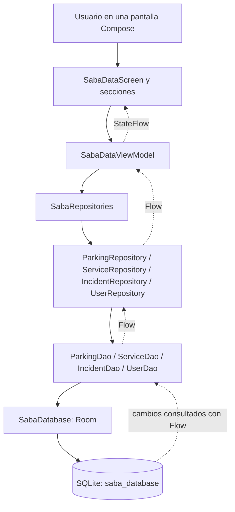
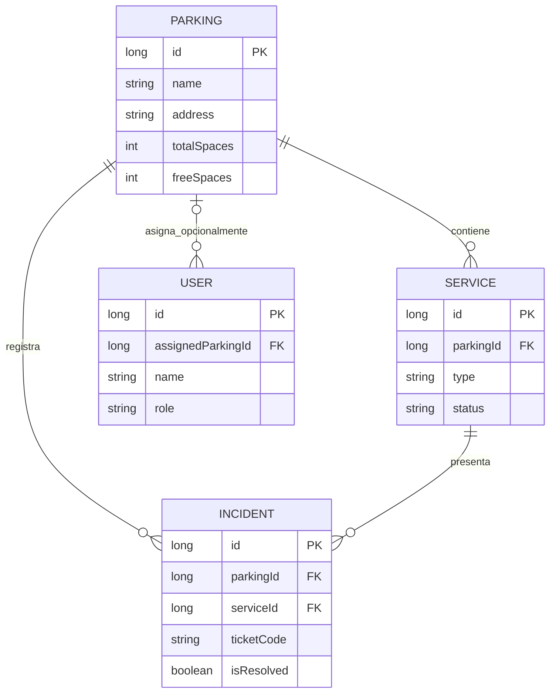

# Saba — Registro completo de trabajo: Room + SQLite

> **Fecha:** viernes 23 de octubre de 2026  
> **Proyecto:** Saba, aplicación Android con Kotlin y Jetpack Compose  
> **Objetivo de la jornada:** completar la capa de persistencia local, conectarla a la interfaz y comprobar su funcionamiento real en un teléfono Android.  
> **Estado al terminar:** **Room + SQLite implementados y funcionales en los flujos probados**; quedan pruebas y mejoras antes de considerar el módulo totalmente validado.  
> **Dispositivo utilizado:** Samsung SM-A145M, Android 15, conectado a Android Studio como dispositivo físico.

---

## Índice

1. [Resumen ejecutivo](#1-resumen-ejecutivo)
2. [Punto de partida y problemas del entorno](#2-punto-de-partida-y-problemas-del-entorno)
3. [Tecnologías y arquitectura](#3-tecnologías-y-arquitectura)
4. [Modelo de datos: cuatro Entities](#4-modelo-de-datos-cuatro-entities)
5. [Los cuatro DAOs](#5-los-cuatro-daos)
6. [Configuración de SabaDatabase](#6-configuración-de-sabadatabase)
7. [Repositories incorporados](#7-repositories-incorporados)
8. [Integración con SabaDataViewModel](#8-integración-con-sabadataviewmodel)
9. [Pantallas de datos locales con Compose](#9-pantallas-de-datos-locales-con-compose)
10. [Navegación desde el Home](#10-navegación-desde-el-home)
11. [Recorrido completo de una incidencia](#11-recorrido-completo-de-una-incidencia)
12. [Pruebas reales efectuadas en el Samsung](#12-pruebas-reales-efectuadas-en-el-samsung)
13. [Pruebas automatizadas preparadas](#13-pruebas-automatizadas-preparadas)
14. [Archivos agregados y modificados](#14-archivos-agregados-y-modificados)
15. [Qué quedó realmente terminado y qué no](#15-qué-quedó-realmente-terminado-y-qué-no)
16. [Limitaciones y decisiones técnicas](#16-limitaciones-y-decisiones-técnicas)
17. [Pendientes y próximos pasos](#17-pendientes-y-próximos-pasos)
18. [Guía de estudio para explicar el módulo](#18-guía-de-estudio-para-explicar-el-módulo)
19. [Conclusión de la jornada](#19-conclusión-de-la-jornada)

---

## 1. Resumen ejecutivo

Durante el día terminamos de incorporar **Room + SQLite como mecanismo de persistencia local de Saba**, conectando las capas de datos con un ViewModel y una pantalla Compose operativa.

### Lo principal que conseguimos

- Conservamos las **cuatro Entities**: `User`, `Parking`, `Service` e `Incident`.
- Conservamos sus **cuatro DAOs** y `SabaDatabase`.
- Completamos/agregamos los cuatro Repositories: `UserRepository`, `ParkingRepository`, `ServiceRepository` e `IncidentRepository`.
- Incorporamos `SabaRepositories` para crear esos Repositories usando una instancia compartida de la base de datos.
- Incorporamos `SabaDataViewModel` con `StateFlow`, `Flow`, `flatMapLatest`, `viewModelScope` y validaciones.
- Añadimos una zona **Administrar datos locales (Room)** con cuatro pestañas: **Estacionamientos**, **Equipos**, **Incidencias** y **Usuarios**.
- Conectamos esta zona al `HomeScreen` sin sustituir el login de prueba que ya funcionaba.
- Compilamos el proyecto en Android Studio, lo instalamos y lo ejecutamos correctamente en un **Samsung real**, evitando el emulador.
- Confirmamos que los registros podían **sobrevivir al cierre y posterior apertura de Saba**.
- Registramos incidencias, guardamos una resolución y comprobamos que el ticket cambió de **Abierto** a **Resuelto**, con una disminución del contador de **Abiertas: 1** a **Abiertas: 0**.
- Dejamos creadas **pruebas instrumentadas** para ampliar la validación, aunque no consta que se hayan ejecutado hoy.

**Distinción fundamental:** la persistencia local se probó de verdad; la totalidad de funciones de todas las pestañas todavía no ha pasado una batería completa de pruebas.

---

## 2. Punto de partida y problemas del entorno

### 2.1 Qué teníamos antes de los cambios de hoy

Saba ya contaba con:

- Proyecto Kotlin + Jetpack Compose.
- Pantallas `LoginScreen` y `HomeScreen` funcionales.
- Login simulado con `FakeAuthApiService` y `AuthRepository`.
- `LoginViewModel` y `HomeViewModel`.
- Cuatro clases Entity, cuatro DAOs y `SabaDatabase` versión 1.

Sin embargo, **la capa de persistencia aún no estaba integrada de extremo a extremo**. En el ZIP de partida, `UserRepository.kt` e `IncidentRepository.kt` estaban vacíos salvo por el `package`, y todavía no existían `ParkingRepository.kt` ni `ServiceRepository.kt`.

Por tanto, que existiera una base de datos declarada **no significaba que las pantallas la utilizaran**.

### 2.2 Problema de recursos con Android Studio

Mientras intentábamos trabajar con Android Studio y el emulador, observamos un consumo considerable de memoria comprometida:

| Momento | Memoria comprometida aproximada |
|---|---:|
| Primera observación | 12,9 / 17,7 GB |
| Aumento posterior | 13,8 / 17,7 GB |
| Tras cerrar un proceso OpenJDK | 10 / 17,7 GB |

Cerrar el emulador por sí solo apenas redujo el consumo. Cerrar un proceso asociado a OpenJDK liberó aproximadamente **3,8 GB de memoria comprometida**. Esto mostró que un proceso Java tenía un consumo importante, **sin identificar con certeza cuál de los procesos de Gradle/Kotlin/Java era**.

Además, los errores rojos que antes mostraba el IDE en las Entities —incluido `Incident.kt`— **ya se habían solucionado** y no eran el bloqueo de ese momento.

> **Nota:** «memoria comprometida» no es lo mismo que memoria RAM física ocupada; incluye memoria respaldada por RAM y por el archivo de paginación.

### 2.3 Cambio al teléfono físico

Decidimos dejar de depender del emulador. Android Studio detectó el dispositivo:

- **Samsung SM-A145M**.
- **Android 15**.
- Arquitectura **ARM64**.
- Estado conectado como **Physical Device**.

Probamos a ejecutar Saba directamente en él y **funcionó**. Esta decisión permitió continuar con pruebas reales sin mantener activo un teléfono virtual, aunque Gradle siguió necesitando memoria para compilar.

Para un computador compartido, es prudente **revocar las autorizaciones de depuración USB al terminar**. Ejecutar la aplicación mediante Android Studio no equivale a modificar el sistema Android ni a flashear el dispositivo.

---

## 3. Tecnologías y arquitectura

### 3.1 Diferencia entre Room y SQLite

**SQLite** es el motor de base de datos relacional integrado en Android. Es el responsable de almacenar físicamente tablas y registros.

**Room** es una biblioteca de Android Jetpack que ofrece una capa sobre SQLite: interpreta anotaciones de Kotlin, ayuda con consultas y genera implementaciones de acceso a datos.

No montamos un servidor SQLite aparte ni añadimos un servidor backend: la base vive **en el almacenamiento privado de la aplicación en el teléfono**.

### 3.2 Arquitectura aplicada



| Capa | Responsabilidad en Saba |
|---|---|
| **Compose** | Dibujar formularios, tarjetas, selectores y botones. |
| **ViewModel** | Recibir acciones, validar entradas, ejecutar corrutinas y mantener datos observables. |
| **Repository** | Centralizar el acceso a los DAOs y aplicar reglas de dominio. |
| **DAO** | Definir consultas y operaciones sobre las tablas mediante Room. |
| **Entity** | Representar el esquema de cada tabla. |
| **SabaDatabase** | Proveer los DAOs y la conexión Room. |
| **SQLite** | Persistir registros en el dispositivo. |

**MVVM** significa *Model–View–ViewModel*. La capa Repository es una decisión adicional de organización que facilita el mantenimiento, pero **no forma parte obligatoria del nombre MVVM**.

---

## 4. Modelo de datos: cuatro Entities

Las cuatro Entities ya estaban declaradas cuando comenzamos a completar los Repositories. Hoy **las conservamos** y construimos sobre ellas, sin cambiar su esquema.

### 4.1 `Parking.kt` → tabla `parkings`

Representa un estacionamiento y su disponibilidad:

| Campo | Tipo | Uso |
|---|---|---|
| `id` | `Long` | Clave primaria autogenerada. |
| `name` | `String` | Nombre del estacionamiento. |
| `address` | `String` | Dirección. |
| `commune` | `String` | Comuna. |
| `totalSpaces` | `Int` | Plazas totales. |
| `freeSpaces` | `Int` | Plazas libres. |
| `isActive` | `Boolean` | Activo/inactivo. |

Ejemplo de creación:

```kotlin
Parking(
    name = "Estacionamiento demo",
    address = "Av. Ejemplo 100",
    commune = "Santiago",
    totalSpaces = 100,
    freeSpaces = 80
)
```

`@PrimaryKey(autoGenerate = true)` permite que Room/SQLite generen el identificador numérico.

### 4.2 `Service.kt` → tabla `services`

Representa un equipo tecnológico asociado a un estacionamiento:

| Campo | Función |
|---|---|
| `id` | Identificador local. |
| `parkingId` | Referencia al estacionamiento. |
| `name` | Nombre del equipo. |
| `type` | Tipo de equipo. |
| `detail` | Detalle o ubicación. |
| `status` | Estado operativo. |
| `lastUpdatedAt` | Fecha de última actualización en milisegundos. |
| `problem` | Problema asociado, si corresponde. |

Tipos que admite la interfaz actual: `barriers`, `lpr`, `pos` y `atm`.

Estados que admite la interfaz actual: `operativo`, `degradado` y `fuera-servicio`.

`parkingId` es clave foránea hacia `Parking.id`. Un equipo no debe quedar asociado a un estacionamiento inexistente.

### 4.3 `User.kt` → tabla `users`

Representa el **perfil local** de un trabajador:

- `id`, `name`, `rut`, `role`, `isActive`, `assignedParkingId`, `cognitoSub`.
- `rut` y `cognitoSub` tienen índices únicos cuando contienen valores distintos de `null`.
- `assignedParkingId` es una referencia **opcional** a un estacionamiento principal.

**No es una tabla de contraseñas ni resuelve el login.** La autenticación sigue siendo una funcionalidad separada.

### 4.4 `Incident.kt` → tabla `incidents`

Registra tickets o incidencias relacionados con equipos:

| Grupo | Campos |
|---|---|
| Identificación | `id`, `ticketCode` |
| Relaciones | `parkingId`, `serviceId`, `reporterUserId`, `resolvedByUserId` |
| Falla | `failureType`, `description`, `status` |
| Reporte | `reporterName`, `reportedAt` |
| Evidencia | `evidenceUri`, `evidenceFileName`, `evidenceMimeType` |
| Resolución | `isResolved`, `resolvedByName`, `resolutionDescription`, `resolvedAt` |

La Entity conserva campos opcionales para evidencia, pero **hoy no añadimos la carga de fotografías o videos**.

`ticketCode` tiene un índice único. La interfaz genera identificadores como `SABA-XXXXXXXX`.

### 4.5 Relaciones entre las Entities



Las relaciones se declaran con `@ForeignKey`. En los vínculos relevantes se utiliza `onDelete = ForeignKey.RESTRICT`, lo que impide eliminar directamente ciertos registros que todavía tienen dependencias.

Hay además referencias **opcionales** desde `Incident` hacia `User` (`reporterUserId` y `resolvedByUserId`). En la interfaz local actual, se permite escribir nombres libres sin requerir un perfil de usuario preexistente.

**Importante:** SQLite garantiza referencias existentes mediante claves foráneas, pero **no comprueba por sí solo** que el equipo indicado en un ticket pertenezca exactamente al `parkingId` del ticket. Por eso agregamos una validación en `IncidentRepository`.

---

## 5. Los cuatro DAOs

DAO significa *Data Access Object*. Define las consultas y operaciones que Room realizará sobre cada Entity.

### 5.1 Anotaciones y operaciones

| Código | Qué hace |
|---|---|
| `@Dao` | Marca una interfaz de acceso a datos. |
| `@Insert` | Inserta un registro (Create). |
| `@Query("SELECT ...")` | Consulta registros (Read). |
| `@Update` | Modifica un registro (Update). |
| `@Delete` | Elimina un registro (Delete). |

Esto permite implementar **CRUD = Create, Read, Update, Delete**.

Ejemplo **real** de `ParkingDao`:

```kotlin
@Insert(onConflict = OnConflictStrategy.ABORT)
suspend fun insert(parking: Parking): Long

@Query("SELECT * FROM parkings ORDER BY name COLLATE NOCASE ASC")
fun observeAll(): Flow<List<Parking>>

@Query("SELECT * FROM parkings WHERE id = :parkingId LIMIT 1")
suspend fun getById(parkingId: Long): Parking?
```

- `ABORT` cancela la operación si viola una restricción relevante.
- `suspend` permite suspender operaciones dentro de corrutinas.
- `Flow<List<Parking>>` permite recibir emisiones sucesivas de la lista cuando cambia la tabla observada.
- `Parking?` indica que la consulta por ID puede devolver `null`.

### 5.2 Métodos existentes por DAO

| DAO | Principales funciones |
|---|---|
| `ParkingDao` | `insert`, `update`, `delete`, `observeAll`, `observeActive`, `getById` |
| `ServiceDao` | `insert`, `update`, `delete`, `observeByParking`, `getById`, `observeById`, `updateStatus` |
| `UserDao` | `insert`, `update`, `delete`, `observeAll`, `getById`, `getByRut`, `observeByParking` |
| `IncidentDao` | `insert`, `update`, `delete`, `getById`, `observeByParking`, `observeActiveByParking`, `observeByService`, `observeActiveCount` |

Dos ejemplos importantes en `IncidentDao`:

```kotlin
@Query("SELECT * FROM incidents WHERE parkingId = :parkingId ORDER BY reportedAt DESC, id DESC")
fun observeByParking(parkingId: Long): Flow<List<Incident>>

@Query("SELECT COUNT(*) FROM incidents WHERE parkingId = :parkingId AND isResolved = 0")
fun observeActiveCount(parkingId: Long): Flow<Int>
```

La primera consulta entrega el historial del estacionamiento elegido. La segunda devuelve cuántos tickets siguen abiertos.

---

## 6. Configuración de SabaDatabase

Archivo: `app/src/main/java/com/example/appsaba/data/local/SabaDatabase.kt`.

Definimos una única clase que reúne las cuatro tablas y expone los cuatro DAOs:

```kotlin
@Database(
    entities = [User::class, Parking::class, Service::class, Incident::class],
    version = 1,
    exportSchema = false
)
abstract class SabaDatabase : RoomDatabase() {
    abstract fun userDao(): UserDao
    abstract fun parkingDao(): ParkingDao
    abstract fun serviceDao(): ServiceDao
    abstract fun incidentDao(): IncidentDao
}
```

La implementación real agrega un `companion object` con `getInstance(context)`, la anotación `@Volatile` y un bloque `synchronized` para reutilizar una **instancia compartida** de Room.

El nombre del archivo es:

```text
saba_database
```

Room lo crea en el almacenamiento privado de la aplicación.

### Dependencias necesarias

La configuración del módulo `app` ya contempla bibliotecas Room y su procesador:

```kotlin
implementation(libs.androidx.room.runtime)
implementation(libs.androidx.room.ktx)
ksp(libs.androidx.room.compiler)
```

El proyecto también declara otra dependencia del catálogo de versiones (`libs.androidx.room3.common`), que conservamos sin alterar su configuración.

**KSP** procesa las anotaciones de Room y ayuda a generar las implementaciones de los DAOs y la base. Durante esta jornada **no cambiamos Gradle ni el esquema Room** en el parche de integración de pantallas.

### Versionado

- Esquema actual: **versión 1**.
- `exportSchema = false` en este MVP.
- Como no alteramos las Entities ni sus relaciones, **no hizo falta una migración de la base de datos** para aplicar la integración.
- Si en el futuro se agregan campos/tablas, habrá que planificar migraciones para conservar los registros.

---

## 7. Repositories incorporados

Esta fue la **primera parte grande de programación que completamos hoy**.

### 7.1 Diagnóstico inicial

Al revisar el ZIP de Saba encontramos:

| Archivo | Estado inicial | Acción |
|---|---|---|
| `AuthRepository.kt` | Existía y se usaba para login | Se conservó. |
| `UserRepository.kt` | Solo contenía declaración de `package` | Se implementó. |
| `IncidentRepository.kt` | Solo contenía declaración de `package` | Se implementó. |
| `ParkingRepository.kt` | No existía | Se creó. |
| `ServiceRepository.kt` | No existía | Se creó. |
| `SabaRepositories.kt` | No existía | Se creó. |

Preparamos un **parche de cinco archivos Kotlin** y también una copia de proyecto con ellos incorporados.

El usuario aplicó los cambios en Android Studio y **confirmó que el proyecto compiló exitosamente**.

### 7.2 Qué hace cada Repository

**`ParkingRepository`** conecta con `ParkingDao` y permite consultar, insertar, actualizar y eliminar estacionamientos.

```kotlin
class ParkingRepository(private val parkingDao: ParkingDao) {
    fun observeAll(): Flow<List<Parking>> = parkingDao.observeAll()
    suspend fun insert(parking: Parking): Long = parkingDao.insert(parking)
    suspend fun update(parking: Parking): Int = parkingDao.update(parking)
    suspend fun delete(parking: Parking): Int = parkingDao.delete(parking)
}
```

*Fragmento abreviado de las operaciones reales; el archivo también contiene `observeActive()` y `getById()`.*

**`ServiceRepository`** conecta con `ServiceDao`, consulta servicios por estacionamiento y permite usar `updateStatus(...)` para cambiar el estado del equipo.

**`UserRepository`** conecta con `UserDao`, consulta perfiles por ID o RUT, permite observar listas y ejecutar operaciones CRUD. **No autentica usuarios.**

**`IncidentRepository`** conecta con `IncidentDao` y `ServiceDao`, consulta tickets y su contador, y **valida la relación equipo–estacionamiento** antes de insertar o actualizar:

```kotlin
private suspend fun validateServiceParking(incident: Incident) {
    val service = serviceDao.getById(incident.serviceId)
        ?: throw IllegalArgumentException(
            "No existe el servicio con id ${incident.serviceId}."
        )
    require(service.parkingId == incident.parkingId) {
        "El servicio ${incident.serviceId} no pertenece al estacionamiento ${incident.parkingId}."
    }
}
```

Así evitamos que se registre una incidencia de un servicio bajo un estacionamiento incorrecto, incluso si ambos identificadores existen.

### 7.3 `SabaRepositories.kt`: dependencias centralizadas

```kotlin
class SabaRepositories(context: Context) {
    private val database = SabaDatabase.getInstance(context.applicationContext)

    val userRepository = UserRepository(database.userDao())
    val parkingRepository = ParkingRepository(database.parkingDao())
    val serviceRepository = ServiceRepository(database.serviceDao())
    val incidentRepository = IncidentRepository(
        database.incidentDao(), database.serviceDao()
    )
}
```

No hay una base de datos por cada pantalla; los Repositories reciben DAOs obtenidos de la misma instancia compartida.

Esta técnica representa una forma sencilla de **inyección manual de dependencias**. Más adelante podríamos utilizar Hilt si el proyecto lo exigiera, pero **no lo necesitamos para que Room funcione**.

### 7.4 ¿Por qué un Repository si ya existe un DAO?

El DAO sabe *cómo* interactuar con la tabla. El Repository decide *qué operación solicitar* y puede incorporar reglas de negocio. Algunos de nuestros métodos delegan directamente al DAO; otros, como la validación de incidencias, añaden comportamiento.

---

## 8. Integración con `SabaDataViewModel`

Esta fue la segunda etapa importante del día. Hasta entonces los Repositories ya compilaban, pero **ninguna pantalla los utilizaba**.

Creamos:

```text
ui/data/SabaDataViewModel.kt
```

**No creamos cuatro ViewModels independientes** para las cuatro tablas; este MVP utiliza **un ViewModel de datos locales** que coordina los cuatro Repositories. Esto es una decisión de implementación para la pantalla integrada actual.

### 8.1 Dependencias por constructor

```kotlin
class SabaDataViewModel(
    private val repositories: SabaRepositories
) : ViewModel()
```

También agregamos `SabaDataViewModelFactory(context)`, que construye `SabaRepositories` y entrega la instancia al ViewModel.

### 8.2 Estados observables (`StateFlow`)

```kotlin
val parkings: StateFlow<List<Parking>> =
    repositories.parkingRepository.observeAll()
        .stateIn(viewModelScope, SharingStarted.WhileSubscribed(5_000), emptyList())
```

Aplicamos el mismo patrón para usuarios. Para equipos e incidencias utilizamos el estacionamiento seleccionado.

```kotlin
private val _selectedParkingId = MutableStateFlow<Long?>(null)

val incidents = _selectedParkingId.flatMapLatest { parkingId ->
    if (parkingId == null) flowOf(emptyList())
    else repositories.incidentRepository.observeByParking(parkingId)
}.stateIn(viewModelScope, SharingStarted.WhileSubscribed(5_000), emptyList())
```

**`flatMapLatest`** permite cambiar la consulta observada cuando se cambia el estacionamiento. Así, al seleccionar otro, la pantalla pasa a recibir **sus incidencias**.

### 8.3 Corrutinas con `viewModelScope`

Las operaciones de escritura se realizan mediante `viewModelScope.launch`, para no ejecutar acceso a datos de forma bloqueante en el hilo de la interfaz.

Agregamos un ayudante llamado `execute(success, task)`:

- Evita iniciar dos operaciones cuando `busy` ya está activo.
- Cambia `busy` a `true` mientras trabaja.
- Ejecuta la función `suspend` indicada.
- Publica un mensaje de éxito o error mediante `feedback`.
- Restaura `busy = false` en `finally`.
- Propaga correctamente `CancellationException`.

### 8.4 Funciones para estacionamientos

- `saveParking(...)`: crea o actualiza según exista o no un ID.
- `toggleParking(parking)`: activa o desactiva el estacionamiento.
- `deleteParking(parking)`: solicita su eliminación.

Validación: nombre y dirección obligatorios; totales y libres numéricos, no negativos y **plazas libres ≤ plazas totales**.

### 8.5 Funciones para equipos

- `saveService(...)`: crea o edita un equipo del estacionamiento seleccionado.
- `setServiceStatus(...)`: admite `operativo`, `degradado` y `fuera-servicio`.
- `deleteService(...)`: solicita eliminación.

### 8.6 Funciones para perfiles locales

- `saveUser(...)`: crea o actualiza perfil, con RUT opcional y asignación opcional.
- `toggleUser(...)`: activa/desactiva.
- `deleteUser(...)`: solicita eliminación.

### 8.7 Funciones para incidencias

- `reportIncident(...)`: registra un ticket local.
- `resolveIncident(...)`: almacena la resolución.
- `deleteIncident(...)`: solicita eliminación.

Validaciones del reporte:

- Estacionamiento y equipo seleccionados.
- Tipo de falla y descripción no vacíos.
- Descripción de hasta **240 caracteres**.
- Gravedad `degradado` o `fuera-servicio`.

El ticket se genera así:

```kotlin
val ticket = "SABA-${UUID.randomUUID().toString().take(8).uppercase()}"
```

Validaciones de resolución:

- Nombre de quien resolvió, obligatorio.
- Descripción de lo realizado, obligatoria.
- Descripción de hasta **300 caracteres**.

Al resolver, se actualizan `isResolved`, `resolvedByName`, `resolutionDescription` y `resolvedAt`.

**Importante:** la resolución no cambia automáticamente el estado de salud del equipo. Un ticket cerrado no demuestra, por sí solo, que el equipo esté completamente operativo.

---

## 9. Pantallas de datos locales con Compose

Creamos una interfaz provisional de administración de la base de datos. Tiene un objetivo funcional y de pruebas; **no representa necesariamente el frontend definitivo que desarrollan los compañeros**.

### 9.1 `SabaDataScreen.kt`

Es el contenedor principal. Observa los `StateFlow` mediante `collectAsState()`, muestra mensajes con `SnackbarHostState`, permite seleccionar estacionamiento y ofrece cuatro pestañas con `ScrollableTabRow`.

En Compose usamos el patrón:

```kotlin
val parkings by model.parkings.collectAsState()
val incidents by model.incidents.collectAsState()
```

Cuando Room emite nuevos registros, el flujo de datos atraviesa Repository y ViewModel hasta actualizar la pantalla **sin pulsar un botón de recarga**.

### 9.2 `ParkingsSection.kt`

Permite:

1. Ingresar nombre, dirección, comuna, plazas totales y libres.
2. Agregar y listar estacionamientos.
3. Cargar datos existentes en un formulario para editarlos.
4. Activar/desactivar.
5. Solicitar eliminación con confirmación.

Muestra un contador `Guardados (N)`.

### 9.3 `ServicesSection.kt`

Permite:

1. Seleccionar un estacionamiento.
2. Ingresar nombre, tipo y detalle de un equipo.
3. Listar equipos de **ese** estacionamiento.
4. Editar datos de equipos.
5. Cambiar estados `operativo`, `degradado`, `fuera-servicio`.
6. Solicitar eliminación con confirmación.

### 9.4 `IncidentsSection.kt`

Permite:

1. Seleccionar estacionamiento y equipo.
2. Escribir tipo de falla, descripción y nombre opcional de quien reporta.
3. Elegir gravedad.
4. Registrar un ticket local.
5. Ver historial, código, equipo, estado y fecha.
6. Ver el contador de incidencias abiertas.
7. Resolver un ticket especificando quién y qué hizo.
8. Solicitar eliminación del ticket.

El historial usa:

```kotlin
"Historial: ${incidents.size} · Abiertas: ${incidents.count { !it.isResolved }}"
```

El listado sigue mostrando los tickets resueltos como parte del historial.

### 9.5 `UsersSection.kt`

Preparamos una pestaña de **perfiles locales**, no de cuentas de login:

- Nombre, RUT opcional, rol y estacionamiento principal opcional.
- Alta, listado, edición, activar/desactivar y eliminación.

La interfaz está implementada; **no consta una validación manual completa de esta pestaña en las capturas de hoy**.

### 9.6 `DataWidgets.kt`

Agregamos componentes reutilizables:

- `ParkingSelector`: chips para cambiar el estacionamiento visible.
- `RecordCard`: tarjeta reutilizable para mostrar registros.
- `ConfirmDelete`: diálogo de confirmación antes de borrar.

Esto evita repetir la misma estructura visual en cada pestaña.

---

## 10. Navegación desde el Home

Solo fue necesario modificar dos archivos existentes en la etapa de integración:

```text
MainActivity.kt
ui/home/HomeScreen.kt
```

En Home agregamos un botón:

```text
Administrar datos locales (Room)
```

En `MainActivity.kt` utilizamos un estado `showLocalData` para decidir qué pantalla mostrar:

```kotlin
if (currentToken == null) {
    LoginScreen(onLoginSuccess = { t -> token = t })
} else if (showLocalData) {
    SabaDataScreen(onBack = { showLocalData = false })
} else {
    HomeScreen(
        accessToken = currentToken,
        onOpenLocalData = { showLocalData = true },
        onLogout = { showLocalData = false; token = null }
    )
}
```

Así mantuvimos el **login simulado existente**. No activamos todavía el `NavHost` definitivo (`AppNavigation` sigue comentado en el flujo principal revisado).

**Alcance:** esta solución permite navegar para probar Room hoy; habrá que integrar la lógica con el frontend final del equipo cuando esté disponible.

---

## 11. Recorrido completo de una incidencia

Este es el flujo más importante que construimos y comprobamos:

```mermaid
sequenceDiagram
    actor U as Usuario
    participant UI as IncidentsSection (Compose)
    participant VM as SabaDataViewModel
    participant R as IncidentRepository
    participant D as IncidentDao
    participant DB as SQLite

    U->>UI: Elige estacionamiento, equipo, falla y gravedad
    U->>UI: Presiona Registrar ticket local
    UI->>VM: reportIncident(...)
    VM->>VM: Valida campos y genera código SABA-...
    VM->>R: insert(incident)
    R->>R: Valida que equipo pertenece al estacionamiento
    R->>D: insert(incident)
    D->>DB: INSERT
    DB-->>D: ID del registro
    DB-->>UI: Cambio observable mediante Flow → StateFlow
    UI-->>U: Nuevo ticket en historial
    U->>UI: Presiona Resolver y escribe solución
    UI->>VM: resolveIncident(...)
    VM->>R: update(incident.copy(isResolved=true,...))
    R->>D: update(incident)
    D->>DB: UPDATE
    DB-->>UI: Lista actualizada
    UI-->>U: Ticket Resuelto; abiertas disminuye
```

### Ejemplo de actualización con `copy()`

```kotlin
repositories.incidentRepository.update(
    incident.copy(
        isResolved = true,
        resolvedByName = resolvedBy.trim(),
        resolutionDescription = solution.trim(),
        resolvedAt = System.currentTimeMillis()
    )
)
```

**`copy()`** crea una versión del objeto con campos cambiados, preservando el ID y el resto de propiedades para que Room actualice el registro existente.

---

## 12. Pruebas reales efectuadas en el Samsung

Esta sección documenta **lo observado durante nuestra conversación y en las capturas**, sin atribuir pruebas que no se realizaron.

### 12.1 Instalación y compilación

- Después de incorporar los Repositories, se confirmó **compilación exitosa**.
- Se instaló y ejecutó la aplicación en el **Samsung físico**.
- Tras agregar la interfaz local, la aplicación volvió a abrir y pudo ejecutar acciones sobre Room.

### 12.2 Registros de estacionamientos

Se observaron **dos estacionamientos de prueba** en la lista, con nombre, dirección, comuna y relación de plazas libres/totales. También se apreciaron cambios en un registro entre capturas.

**Resultado confirmado:** la pantalla permite crear, consultar y recuperar estacionamientos guardados localmente. **No se ejecutó una prueba sistemática de eliminación.**

### 12.3 Registros de equipos

En la pestaña **Equipos** se observó un equipo asociado al estacionamiento seleccionado. Aparecía su tipo y el estado `degradado`.

**Resultado confirmado:** se pudo registrar/consultar un equipo y observar su estado en la interfaz. Los botones para cambiar estado, editar y borrar estaban implementados. No se documentó cada variación posible con una captura independiente.

### 12.4 Tickets registrados

Se visualizaron tickets con:

- Código `SABA-...`.
- Equipo relacionado.
- Tipo de falla.
- Estado/gravedad.
- Descripción.
- Fecha y nombre del reportero, si se informó.
- Contador de historial y de abiertas.

Una captura mostró el mensaje:

```text
Incidencia registrada localmente en SQLite
```

En otra se observó un ticket **Abierto** con **Historial: 1 · Abiertas: 1**.

### 12.5 Resolución de incidencia

En la prueba de las **17:08**, se abrió el formulario de resolución de un ticket. Se ingresó una persona resolutora y una descripción de lo realizado, y luego se guardó.

El ticket usado para comprobar el cambio fue:

```text
SABA-C34EABDF
```

**Antes:**

```text
SABA-C34EABDF · Abierto
Historial: 1 · Abiertas: 1
```

**Después:**

```text
SABA-C34EABDF · Resuelto
Historial: 1 · Abiertas: 0
```

La tarjeta pasó a mostrar también el nombre de quien resolvió y la descripción de la solución.

### 12.6 Persistencia después del cierre completo

Se probó cerrar Saba mediante **Ajustes → Aplicaciones → Saba → Forzar detención** y volver a abrirla normalmente desde el teléfono.

- Los datos guardados previamente **seguían apareciendo**.
- El usuario confirmó que el estado resuelto también se conservó al reabrir la app.
- Las capturas tomadas cerca de las **17:09** volvieron a mostrar `Resuelto` y **Abiertas: 0**.

**Conclusión específica de esta prueba:** los datos del recorrido validado se conservaron **más allá del proceso activo de Saba**. Esto constituye una comprobación práctica de persistencia en SQLite.

### 12.7 Matriz de evidencias al cierre del día

| Prueba | Estado | Base del resultado |
|---|---|---|
| Compilación con Repositories | ✅ Confirmada | Reporte directo de compilación exitosa. |
| Ejecutar en dispositivo físico | ✅ Confirmada | Android Studio reconoció y ejecutó Saba en Samsung. |
| Crear/listar estacionamientos | ✅ Confirmada | Capturas con registros guardados. |
| Crear/listar equipos | ✅ Confirmada | Captura con equipo y estado. |
| Registrar/listar incidencias | ✅ Confirmada | Capturas, ticket y mensaje de SQLite. |
| Resolver una incidencia | ✅ Confirmada | Cambio visible `Abierto → Resuelto`. |
| Contador de abiertas actualizado | ✅ Confirmada | Cambio `1 → 0`. |
| Persistencia después de forzar detención | ✅ Confirmada | Reporte del usuario y capturas posteriores. |
| Editar todos los tipos de registro | ◻️ Parcial | Existen controles y se observaron cambios, pero no todos los caminos están documentados. |
| Eliminar y comprobar restricciones | ⏳ Pendiente | No hay confirmación de una prueba completa. |
| CRUD completo de perfiles `User` | ⏳ Pendiente | Se implementó la pestaña; falta probarla integralmente. |
| Pruebas instrumentadas JUnit | ⏳ Pendiente | Archivos preparados; ejecución no confirmada. |
| Sincronización con API o servidor | ❌ No implementada | La base de datos es local. |

**Leyenda:** ✅ observado/comprobado · ◻️ solo parcialmente evidenciado · ⏳ falta comprobar · ❌ fuera del alcance implementado.

---

## 13. Pruebas automatizadas preparadas

Se agregó:

```text
app/src/androidTest/java/com/example/appsaba/SabaRoomIntegrationTest.kt
```

Incluye dos pruebas instrumentadas con `AndroidJUnit4`:

### 13.1 `guardarConsultarActualizarYValidarRelacion()`

- Crea una base Room **en memoria**.
- Inserta estacionamiento y equipo.
- Inserta ticket con `IncidentRepository`.
- Comprueba que aparece una incidencia y que hay una abierta.
- Marca el ticket resuelto y verifica que el contador cae a cero.
- Intenta asociar el equipo a otro estacionamiento y exige que la validación lo rechace.
- Cierra la base al terminar.

### 13.2 `laBasePersisteAlCerrarYReabrir()`

- Utiliza una base de prueba llamada `saba_test_persistencia.db`.
- Inserta un estacionamiento.
- Cierra la base.
- La abre de nuevo.
- Comprueba que el estacionamiento conserva su nombre.
- Elimina la **base de prueba** al terminar.

Estas pruebas **no utilizan ni borran la base `saba_database` del usuario**.

**Estado:** los métodos quedaron escritos e incorporados en el código, pero no debemos afirmar que pasaron automáticamente porque no tenemos registro de ejecución de la suite en Android Studio.

---

## 14. Archivos agregados y modificados

### 14.1 Parche de Repositories (primera entrega del día)

**Cinco archivos nuevos o completados:**

```text
app/src/main/java/com/example/appsaba/data/repository/
├── UserRepository.kt
├── ParkingRepository.kt
├── ServiceRepository.kt
├── IncidentRepository.kt
└── SabaRepositories.kt
```

Se conservó `AuthRepository.kt`.

### 14.2 Parche Room + SQLite (segunda entrega del día)

**Siete archivos de interfaz y lógica:**

```text
app/src/main/java/com/example/appsaba/ui/data/
├── SabaDataViewModel.kt
├── SabaDataScreen.kt
├── ParkingsSection.kt
├── ServicesSection.kt
├── IncidentsSection.kt
├── UsersSection.kt
└── DataWidgets.kt
```

**Dos archivos existentes modificados:**

```text
app/src/main/java/com/example/appsaba/MainActivity.kt
app/src/main/java/com/example/appsaba/ui/home/HomeScreen.kt
```

**Prueba añadida:**

```text
app/src/androidTest/java/com/example/appsaba/SabaRoomIntegrationTest.kt
```

**Documentación añadida con el parche:**

```text
docs/10_room_sqlite_integracion.md
```

Las Entities, los DAOs y `SabaDatabase` **no se modificaron en el segundo parche**. Tampoco alteramos `app/build.gradle.kts` ni el flujo de autenticación ya operativo.

### 14.3 Entregables ZIP que utilizamos

1. `Saba_Parche_Repositories.zip`: archivos para completar Repositories.
2. `Saba_Proyecto_Repositories.zip`: copia del código fuente con Repositories.
3. `Saba_Parche_Room_SQLite.zip`: archivos para conectar ViewModel y Compose.
4. `Saba_Proyecto_Room_SQLite.zip`: copia del código fuente tras esa integración.

Se recomendó aplicar **parches sobre el proyecto ya funcional**, previa copia de seguridad, para reducir la posibilidad de perder cambios.

---

## 15. Qué quedó realmente terminado y qué no

### 15.1 Ya implementado

- Esquema Room con cuatro Entities y claves foráneas.
- Cuatro DAOs.
- `SabaDatabase` compartida.
- Cuatro Repositories locales y contenedor `SabaRepositories`.
- ViewModel de datos locales con corrutinas y estado observable.
- Cuatro secciones funcionales de administración.
- Acceso desde Home a «Datos locales».
- Validación de integridad equipo–estacionamiento en incidencias.
- Alta, consulta y resolución de incidencias en SQLite.

### 15.2 Comprobado en ejecución

- Compilación y ejecución en teléfono físico.
- Inserción y visualización de registros usados en las pruebas.
- Persistencia después de detener/reabrir la aplicación.
- Resolución y cambio de contador de incidencias abiertas.

### 15.3 Todavía por validar completamente

- Eliminación en todas las tablas, incluyendo casos con claves foráneas.
- CRUD completo de perfiles de usuario.
- Todos los caminos de edición y cambio de estados.
- Ejecución de la suite instrumental.
- Casos límite: datos vacíos, duplicados, IDs inválidos, cambio de estacionamiento y posibles errores al escribir.

**Conclusión precisa:** podemos dar la **implementación principal de Room + SQLite por terminada**, pero todavía quedan verificaciones antes de declararla completamente probada o lista para producción.

---

## 16. Limitaciones y decisiones técnicas

### 16.1 Persistencia local, no backend remoto

La información reside **en el dispositivo que ejecuta Saba**. No se sincroniza automáticamente con otros teléfonos.

Room/SQLite son parte de la capa local de datos de una aplicación Android. **No equivalen a una API REST ni a una base de datos compartida en un servidor.**

### 16.2 Autenticación separada

El login que funciona actualmente utiliza un servicio de autenticación **simulado** en depuración. La tabla `User` no valida contraseñas.

Amazon Cognito y la integración real con backend siguen siendo tareas separadas de este módulo.

### 16.3 Integridad de relaciones

- Room/SQLite restringen eliminar ciertos registros si existen dependencias.
- `IncidentRepository` verifica que el equipo pertenece al estacionamiento elegido.
- Un mensaje de error al intentar borrar un estacionamiento con equipos relacionados puede ser una **protección intencional**, no un fallo del ORM.

### 16.4 Tickets y UUID

El código usa ocho caracteres de un UUID aleatorio. Las colisiones son improbables en un MVP, pero **no imposibles**. El índice único protege la tabla ante duplicados que lleguen a ocurrir.

### 16.5 Resolución vs. estado del equipo

Un ticket puede estar `Resuelto` mientras el equipo permanece `degradado` o `fuera-servicio`. Los conceptos son distintos y por ahora se actualizan de forma independiente.

### 16.6 Almacenamiento y privacidad

- La app utiliza almacenamiento interno privado para la base Room.
- No almacena contraseñas en `User`.
- El proyecto actual **no ha implementado cifrado adicional de base de datos** ni un modelo completo de permisos por roles.
- No hay auditoría histórica de todas las ediciones o eliminaciones.
- `evidenceUri` existe en el esquema, pero adjuntar y retener evidencia todavía requiere implementar manejo de permisos y archivos.

### 16.7 Migraciones futuras

Al introducir nuevos campos o cambiar relaciones, la base deberá subir de versión y gestionar una migración de Room. No se recomienda borrar datos o usar migraciones destructivas como respuesta automática a un error.

### 16.8 Atomicidad

Hoy registrar una incidencia **no actualiza automáticamente** el estado del equipo. Si más adelante ambas operaciones deben ocurrir juntas, convendrá envolverlas en una **transacción Room** para garantizar que se completen conjuntamente o fallen conjuntamente.

---

## 17. Pendientes y próximos pasos

### 17.1 Cierre de pruebas de Room

- [ ] Probar creación, edición, consulta y eliminación de perfiles locales.
- [ ] Eliminar un registro sin relaciones y comprobar que desaparece tras reabrir Saba.
- [ ] Intentar eliminar un estacionamiento referenciado y verificar que SQLite lo impide.
- [ ] Ejecutar `SabaRoomIntegrationTest.kt` en Android Studio con el Samsung.
- [ ] Probar validaciones con entradas inválidas y campos obligatorios.
- [ ] Hacer una copia de seguridad/captura del estado estable antes de nuevos cambios.

### 17.2 Próximos módulos de Saba

- [ ] Autenticación real y configuración de Amazon Cognito, según los requisitos del proyecto.
- [ ] Integrar API/backend remoto cuando corresponda, determinando qué datos permanecen locales y cuáles requieren sincronización.
- [ ] Integrar el frontend de los compañeros con **los ViewModels/Repositories existentes**, en vez de reescribir la persistencia desde las pantallas.
- [ ] Conectar la navegación y permisos reales por rol cuando estén definidos.
- [ ] Mejorar diseño responsivo y usabilidad: espaciado, formularios, chips y distribución de botones.

**Organización del equipo:** el núcleo funcional se está trabajando por separado del diseño visual. Se fijó el **domingo 25 de octubre por la noche** como límite para recibir el frontend de los compañeros; el **lunes 26** se decidirá cómo integrarlo o cómo adaptar la interfaz funcional existente. La entrega de Saba está prevista para el **martes 27 de octubre**.

Esta organización **no cambia el estado técnico de Room**: el módulo ya puede funcionar con las pantallas locales de prueba, aunque todavía falte una interfaz definitiva.

---

## 18. Guía de estudio para explicar el módulo

### ¿Por qué utilizamos Room y no SQL directamente desde la pantalla?

Porque Room integra SQLite con Kotlin mediante Entities y DAOs, ayuda con las consultas y mantiene la lógica de persistencia separada de Compose. Una pantalla no debería escribir SQL directamente.

### ¿Qué diferencia hay entre Entity, DAO y Repository?

- **Entity:** describe la estructura de un registro/tabla.
- **DAO:** declara cómo leer o escribir datos en la tabla.
- **Repository:** encapsula el acceso a los DAOs y puede aplicar reglas del negocio.

### ¿Qué aporta el ViewModel?

Conserva el estado y coordina operaciones sin mezclar lógica de datos con el dibujo de la pantalla. En nuestro caso, utiliza `viewModelScope` y expone `StateFlow`.

### ¿Qué diferencia hay entre `Flow` y `StateFlow`?

`Flow` representa un flujo de emisiones asíncronas; Room lo usa para consultas observables. `StateFlow` mantiene siempre un valor de estado actual, práctico para una interfaz Compose. Convertimos algunos `Flow` a `StateFlow` con `stateIn(...)`.

### ¿Qué prueba que los datos son persistentes?

Se insertaron registros, se detuvo completamente la aplicación y se volvió a abrir. Los registros y el estado `Resuelto` siguieron apareciendo. Como el estado sobrevivió al proceso de la app, no se trataba solo de datos en memoria del ViewModel.

### ¿Por qué usar `ForeignKey.RESTRICT`?

Para impedir eliminaciones que dejarían referencias inválidas. No deberíamos borrar un estacionamiento sin considerar sus equipos, usuarios asignados e incidencias.

### ¿Por qué el Repository valida el estacionamiento de una incidencia?

Porque una referencia a `Service` y otra a `Parking` podrían existir individualmente, pero no necesariamente corresponder a la misma relación correcta. La validación previene registros inconsistentes.

### ¿La base está en Internet?

No. Es SQLite local del teléfono. La futura comunicación con un backend remoto es independiente.

### ¿El proyecto está listo para producción?

No. Ya hay una implementación local funcional y probada en sus recorridos principales, pero faltan validación completa, seguridad, usuarios reales, API, sincronización y tratamiento de errores de producción.

---

## 19. Conclusión de la jornada

Al comenzar el día, Saba tenía las clases de Room declaradas, pero la aplicación no utilizaba plenamente esa infraestructura desde sus pantallas. Terminamos con un circuito real y funcional:

```text
Usuario → Compose → SabaDataViewModel → Repository → DAO → Room → SQLite
                                 ↑                              |
                                 └──────── Flow / StateFlow ─────┘
```

El punto decisivo no fue solo que Android Studio compilara, sino la **prueba real en el Samsung**: se registraron estacionamientos, equipos e incidencias, se resolvió un ticket, el contador de abiertas disminuyó y los datos se conservaron después de detener y volver a abrir la aplicación.

**Resultado final del 23 de octubre de 2026:**

> **La integración principal de Room + SQLite en Saba quedó implementada y funcionando en los flujos validados.** El módulo dispone de una base sobre la cual integrar el frontend definitivo y las futuras conexiones remotas, con una pequeña lista de pruebas pendientes para cerrar el CRUD completo.

---

### Referencias internas del proyecto

- `app/src/main/java/com/example/appsaba/data/model/`
- `app/src/main/java/com/example/appsaba/data/local/`
- `app/src/main/java/com/example/appsaba/data/repository/`
- `app/src/main/java/com/example/appsaba/ui/data/`
- `app/src/main/java/com/example/appsaba/MainActivity.kt`
- `app/src/androidTest/java/com/example/appsaba/SabaRoomIntegrationTest.kt`
- `docs/10_room_sqlite_integracion.md`

*Documento construido a partir del código fuente de los parches trabajados el 23-10-2026, las pruebas relatadas y las capturas de ejecución en el Samsung. No sustituye las pruebas automáticas pendientes.*
