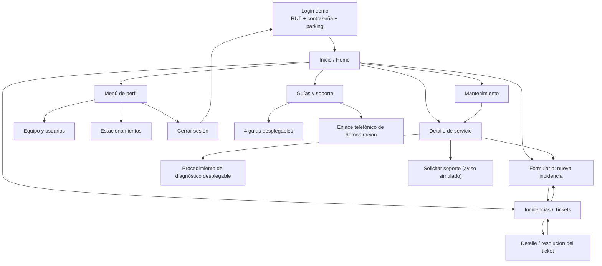

# 02 — Mapa de navegación

**Fuente:** Figma Make `src/App.tsx`: tipo `Page` (líneas 5–11), `BottomNav` (~1713), `MobileApp` (~1742) y `ProfileMenu` (~1654). [FIGMA-IMPLEMENTADO]

### Pestañas principales

| Pestaña inferior | ID interno en Figma | Componente del prototipo |
|---|---|---|
| Inicio | `inicio` | `Dashboard` |
| Incidencias | `incidencias` | `IncidentsPage` |
| Guías | `guias` | `GuidesPage` |
| Mantenimiento | `mantenimiento` | `MaintenancePage` |

`parking` y `usuarios` **no aparecen** en la barra inferior; se abren desde `ProfileMenu`.

## Reglas observadas

- El menú de perfil abre las vistas administrativas y permite salir del demo.
- Al abrir un servicio desde **Mantenimiento**, se cambia a la pestaña Inicio y se presenta `ServiceDetail`.
- `IncidentForm` es un único formulario compartido, abierto desde Home, Incidencias o detalle del servicio.
- Si se abre desde un servicio, puede recibir equipo, tipo de falla y estado como valores iniciales.
- El login muestra selector de estacionamiento, **pero el código del prototipo no utiliza el valor seleccionado** para cambiar Home; allí sigue mostrándose Plaza Italia. No documentar esa asignación como funcional.
- El aviso de notificaciones del encabezado tiene apariencia visual, sin interacción conectada en el código inspeccionado.

## Pendiente para Android

Proponer nombres de rutas Compose solo al definir la navegación real. No introducir Navigation Compose si no es necesario para el primer MVP; pero con >4 destinos y modales quizá convenga cuando la aplicación crezca. **Eso es una decisión técnica, no algo realizado en Figma.**
