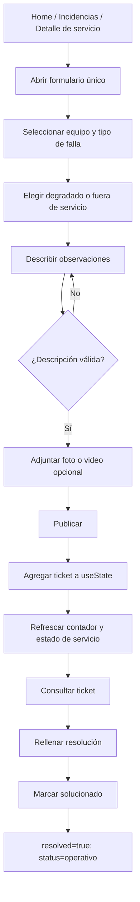
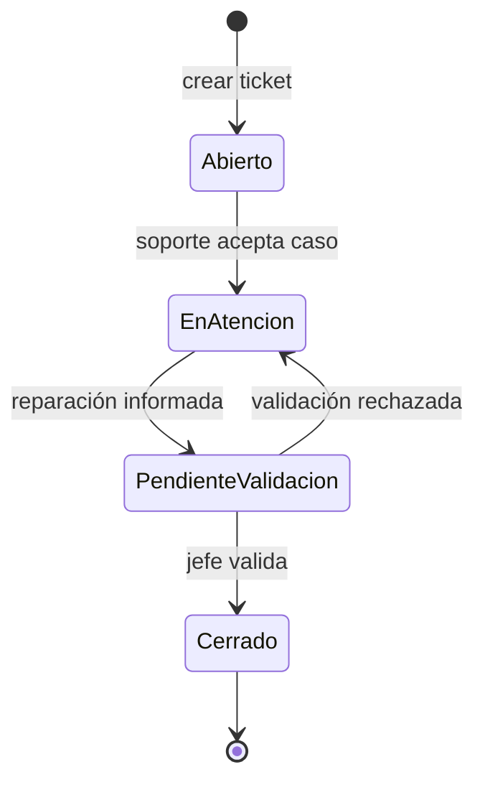
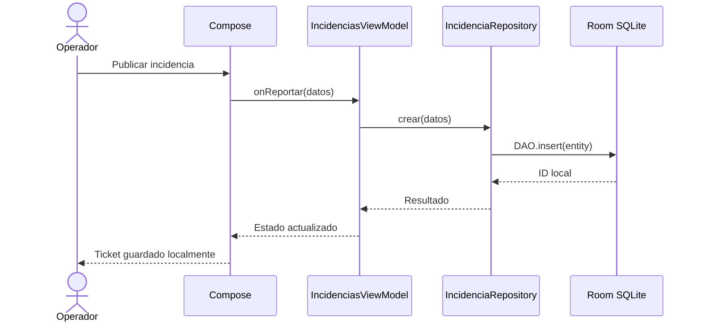

# 04 — Flujo de incidencias

## A. Flujo observado en Figma [FIGMA-IMPLEMENTADO]

El paso H **no** realiza una publicación real: es una mutación del estado React local. Tampoco se envían fotos al SAU o se actualiza otro dispositivo.

## B. Diagrama de estados — propuesta para Android [PROPUESTA]

Figma mezcla `operativo/degradado/fuera-servicio` (salud del **servicio**) con `resolved` (cierre del **ticket**). Se recomienda separarlos.

**Estados propuestos de incidencia:** `ABIERTO`, `EN_ATENCION`, `PENDIENTE_VALIDACION`, `CERRADO`.
**Estados observados de servicio:** `operativo`, `degradado`, `fuera-servicio`.

Ninguno de estos cuatro estados de ticket adicionales está implementado en Figma. Antes de construirlos hay que validarlos con el docente/cliente; se derivan del requisito de trazabilidad y validación de resolución.

## C. Reglas de negocio a confirmar

- ¿El operador puede cerrar un ticket o solamente un jefe?
- ¿Se permite reportar múltiples fallas en el mismo equipo?
- ¿Un ticket cerrado cambia el estado del equipo automáticamente? ¿Y si hay otros tickets abiertos?
- ¿Cómo se generan códigos sin colisiones entre distintos dispositivos?
- ¿Una incidencia se guarda primero en Room aunque no haya conexión? Si hay sincronización posterior, ¿cómo se resuelven conflictos?
- ¿Existe API/contrato del SAU? La presentación lo menciona, **pero Figma no lo integra**.

## D. Ejemplo de secuencia para Android [PROPUESTA]

Este diagrama no dice «enviado al SAU» ni «visible al equipo», porque esas funciones requieren un backend.
