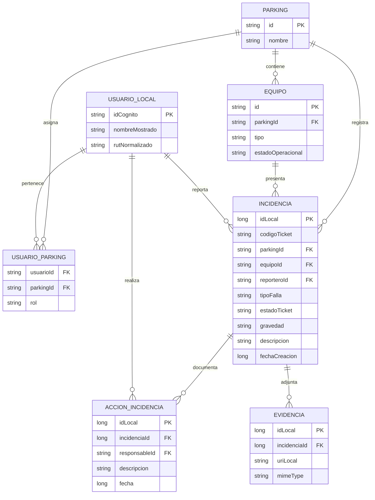

# 06 — Modelo de datos para Room (propuesta)

## Origen de campos observados en Figma

`App.tsx` declara:

- `Incident`: id, ticketCode, reporter, equipment, type, parking, description, status, occurredAt, image, fileName, fileType, resolved?, resolvedBy?, resolutionDescription?, resolvedAt?.
- `ServiceDefinition`: id, name, detail, icon, incidentType, initialStatus, lastUpdated, problem?.
- `OperationalService`: definición de servicio + status calculado + última incidencia.
- `parkings` y `team`: **arreglos constantes de demostración**.

Esto describe **datos del prototipo**, no tablas existentes en SQLite.

## Entidades sugeridas [PROPUESTA; AÚN NO ESQUEMA APROBADO]

## MVP reducido para implementación académica

No crear 7 tablas de golpe. Primera iteración útil:

1. `IncidenciaEntity` con `idLocal`, equipo, tipo de falla, descripción, gravedad, estado de ticket y fecha.
2. `IncidenciaDao`: insertar, observar listado, consultar por ID y actualizar resolución.
3. `SabaDatabase` y `IncidenciaRepository`.
4. `IncidenciasViewModel` con `StateFlow` y pantalla de listado.
5. Agregar después `ParkingEntity`, `EquipoEntity` y `UsuarioLocalEntity` cuando se definan IDs y relaciones.

Se había entregado un parche académico de cuatro archivos Room de incidencias; **no está confirmada su incorporación** a Android. No confundir este modelo ampliado con ese parche.

## Decisiones técnicas pendientes

- ¿ID local numérico y/o ID remoto estable? No usar `Date.now().slice(-6)` como clave global única.
- ¿Cómo se guarda evidencia? Preferir metadatos/URI con permisos adecuados; no duplicar blobs enormes de imágenes/video en filas Room sin justificarlo.
- ¿La base será puramente local o caché de un servidor? Room **no sincroniza otros teléfonos automáticamente**.
- ¿Qué campo pertenece a autenticación y cuál a perfil operativo?
- ¿Qué políticas de borrado, retención y privacidad se aplican a RUT y evidencias?
- ¿Cómo versionar el esquema y crear migraciones al cambiar Entities?
