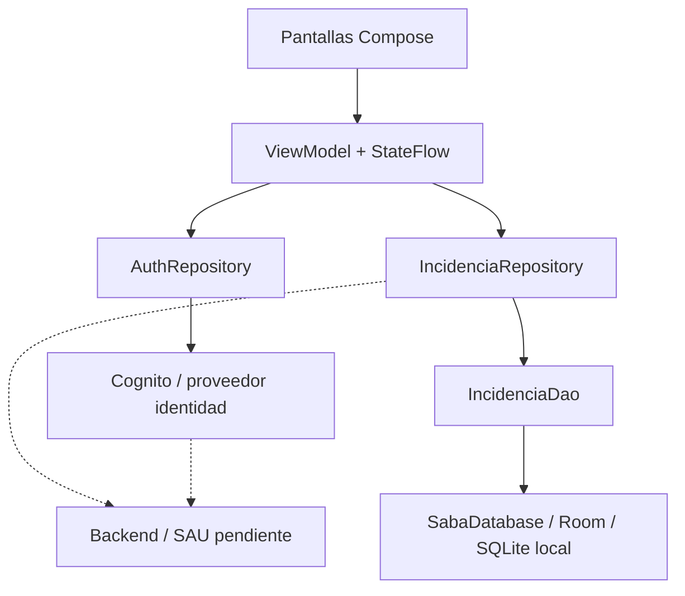

# 07 — Arquitectura Kotlin / Compose / MVVM

## Arquitectura prevista



Las flechas hacia Cognito y backend indican **arquitectura objetivo**; no están implementadas en el prototipo Android confirmado.

## Responsabilidad por capa

| Capa | En Kotlin | Responsabilidad |
|---|---|---|
| View | `@Composable` | Renderizar datos y emitir eventos. |
| ViewModel | `ViewModel` + `StateFlow` | Validar acciones de UI, coordinar y publicar estados. |
| Repository | Clases normales | Abstraer acceso a fuente local/remota. |
| DAO | `@Dao` | SQL y persistencia de Room. |
| Database | `@Database` | Declarar tablas, versión y DAOs. |
| DTO | `data class` | Contratos de entrada/salida de API, cuando exista API. |
| Auth | `AuthRepository` | Login, sesiones y error de autenticación. |

## Organización de carpetas sugerida [PROPUESTA]

```text
app/src/main/java/com/example/appsaba/
  core/
    config/
    jwt/
  data/
    local/
      entity/
      dao/
      SabaDatabase.kt
    remote/
      auth/
      tickets/              # futuro backend
    repository/
      AuthRepository.kt
      IncidenciaRepository.kt
  ui/
    login/
    home/
    incidencias/
    guias/
    mantenimiento/
    usuarios/
    estacionamientos/
    components/
```

**Importante:** esta es una propuesta; si ya existen rutas diferentes que funcionan, adaptar la propuesta a la estructura real y NO mover archivos masivamente.

## Flujo de datos recomendado

- UI envía eventos: `onReportar(...)`.
- ViewModel invoca repositorio desde una corrutina; muestra loading/errores.
- Repository opera con el DAO (y, cuando exista, API).
- `Flow`/`StateFlow` entrega resultados; Compose los observa con lifecycle.
- La UI nunca ejecuta SQL ni valida autorizaciones definitivas.

## Diferencia entre Figma y Android

En Figma Make `MobileApp` guarda `incidents` en `useState`. En Android, al migrar se debe guardar en Repository/Room para persistencia local. **No copiar literalmente `App.tsx` a Kotlin**: la referencia es el comportamiento, no la estructura monolítica.
